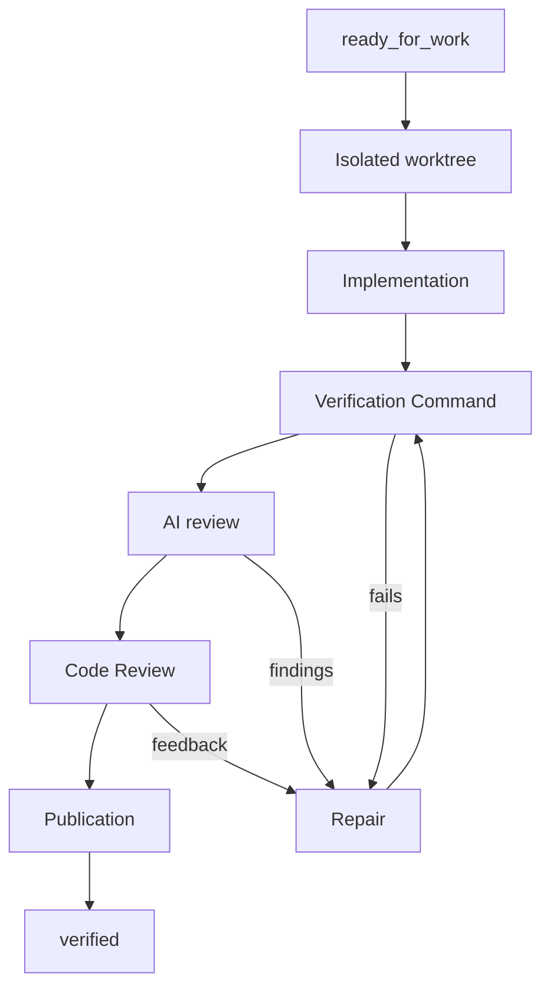

# Product Requirements Document (PRD): RunWield Core

**Document role: Living central PRD.** Shared local workflow principles and lasting Core product requirements.

This PRD defines the user needs and outcomes for **RunWield Core**: local planning, execution, conversation, validation,
and recovery. [Domain language](../domain-language.md) defines the shared product terms. Architectural choices belong in
ADRs, implementation steps and remaining work in Plans, and delivery evidence in Work Records. Fold lasting requirements
from completed feature PRDs into this document.

Each capability states its scope and maturity. A listed capability does not establish that every journey using it is
complete.

## Vision & Strategy

**RunWield Core** is an opinionated, local-first coding harness for AI-partnered software planning and execution. It
replaces "chat-and-hope" AI with Plan-by-Default work: requests go to specialized Agents, project and Session context
persist, implementation work is validated, and durable Plan artifacts stay in the repository.

Core is the free local engine behind the broader RunWield product:

- local `wld` CLI
- interactive TUI
- local browser Workspace client
- Plan lifecycle and validation workflows
- local Markdown Plans, PRDs, ADRs, and Work Records
- Agent definitions, skills, tools, and model configuration
- consistent Sessions and workflows across TUI, ACP, and Workspace

Core stays compatible with `@earendil-works/pi-coding-agent` conventions, APIs, Session behavior, model and provider
configuration, and skill and tool ecosystem expectations. RunWield diverges only where its planning, lifecycle,
validation, memory, or Workspace goals need a distinct product surface.

## Core Philosophies

- **Plan-by-Default:** Material work becomes a reviewed Plan unless it is an `INQUIRY`, an `OPERATION`, or a `QUICK_FIX`.
- **Right ceremony for the request:** Router matches the workflow to the request, so simple tasks stay light and large
  work gets a complete specification.
- **Artifacts over vibes:** Plans, PRDs, ADRs, and Work Records are durable project memory.
- **Session continuity:** Fresh Sessions start with Router. Follow-up messages stay with the specialist that owns the
  topic until the user starts fresh or returns to Router.
- **Work protection:** RunWield preserves user work and asks before any action that could destroy it.
- **Tool-driven workflow:** Agents declare intent with workflow tools; orchestration code owns lifecycle transitions,
  execution, validation, and recovery.
- **Local-first control:** Core is fully useful without the hosted Workspace.
- **Context parsimony:** Agents use targeted project context, memory recall, code intelligence, and Plan artifacts.
- **Pi compatibility by default:** RunWield follows Pi Coding Agent conventions where its product vision allows.
- **Extensible but guarded:** Users customize Agents, skills, prompt templates, and tools; protected workflow tools keep
  Core workflows intact.
- **Two workflow conclusions:** A delivery workflow ends with confirmed publication or the user's deliberate
  abandonment. RunWield repairs its own machinery. See
  [Workflow completion and automatic recovery](#workflow-completion-and-automatic-recovery).

## Capability Requirements

Each capability below owns its named requirements and acceptance scenarios. Scope labels record product commitments;
they are not a release audit. Other capabilities and surfaces link to these requirements and add only their own
behavior.

- [TUI conversation](#tui-conversation)
- [Agent mascots](#agent-mascots)
- [Request routing](#request-routing)
- [Plan review](#plan-review)
- [Plan authoring and external adoption](#plan-authoring-and-external-adoption)
- [Plan lifecycle](#plan-lifecycle)
- [Epic decomposition and hold](#epic-decomposition-and-hold)
- [Execution, validation, and recovery](#execution-validation-and-recovery)
- [Semantic review and repair](#semantic-review-and-repair)
- [Standalone code review](#standalone-code-review)
- [Frontend engineering and pair execution](#frontend-engineering-and-pair-execution)
- [Theme selection](#theme-selection)
- [Project context and initialization](#project-context-and-initialization)
- [Tutorial](#tutorial)
- [Compaction and image context](#compaction-and-image-context)
- [Image generation](#image-generation)
- [Work records](#work-records)
- [Agent and skill customization](#agent-and-skill-customization)
- [Models and providers](#models-and-providers)
- [Installation and updates](#installation-and-updates)
- [Remote connection](#remote-connection)
- [Work protection](#work-protection)
- [Session continuity](#session-continuity)
- [Capability-organized product requirements](#capability-organized-product-requirements)
- [Local workflow metrics](#local-workflow-metrics)

### TUI conversation

**Scope and maturity:** Current baseline. The TUI is the primary interactive Core client. Core owns command meaning;
each surface owns which commands it offers and how it presents questions.

**Requirement: Keep follow-ups with the active specialist.** New Sessions start with **Router**. After Router hands off
to a specialist, that specialist stays the active root Agent for follow-up messages. Accepted task completion settles
the Agent turn and its transcript writes before Core releases the Session, so the next message is accepted on its first
submission.

Users can:

- use `/new` to start a fresh routed Session;
- use `/agent router` to route the next message in the same Session;
- use `/resume` to resume a chat Session;
- use `/load-plan <plan>` to resume a Plan workflow.

**Requirement: Agent selection replaces active instructions.** Switching Agents keeps the conversation history and
gives the model the selected Agent's system instructions and tools. Earlier Agents' instructions remain history only,
including after Session resume. A successful change to a different Agent produces one conversation notice.

**Requirement: Preserve steering through an Agent handoff.** When a workflow event starts a handoff, Core settles the
outgoing Agent turn before the replacement Agent starts provider work. Steering Messages sent from that point go to the
replacement Agent once, in order, with their text, images, and notification destination intact. Core reports a message
as consumed when the replacement Agent receives it. If replacement setup fails, the previous Agent stays active and
keeps the pending messages. Canceling the Session clears pending messages and ends the handoff.

**Requirement: Commands are commands.** A leading slash that resolves to an available command runs that command.
Disabled or unknown commands fail visibly. A fully typed `/load-plan <plan>` opens that exact Plan with one Enter;
partial names stay discoverable through completion. Background Task results reach the Agent as information: they keep
the unsent draft and the active specialist unchanged and never run as commands.

**Requirement: Restore complete saved conversation history.** Resuming a Session renders its committed history in
order through the final saved message, once per event, across any number of replay pages. Replay shows the transcript
without running saved requests or tools. Each Session's replay delivers only its own history.

**Requirement: Show workflow progress in the sidebar through delivery and resume.** The sidebar follows planning,
clarification, Plan review, implementation, the **Verification Command**, AI review, repair, Code Review, publication,
and completion. Each stage shows its status once. A running repair stays the current stage, with its failed check
visible. **Answer agent** and its question detail appear while a question is
pending and clear as soon as the user answers or cancels it on any surface. TUI shortcuts reopen review or resume saved
work.

Validation progress and the latest settled checkpoint survive panel dismissal and Session reopening. Newer phases and
confirmed completion always take precedence over older checkpoints. A new workflow starts with fresh progress. Confirmed
delivery to the configured target completes the sidebar; the onward merge or PR is the owner's responsibility.

Delivery cards label the automatic review **AI Code Review**, the user's review **Code Review**, the configured check
**Verification Command**, integration **Merge worktree**, and the owner's manual check **User verification**.

**Requirement: Offer the next Session action after delivery.** After confirmed Plan publication, the TUI removes the
review and publishing panel and keeps the outcome in the conversation. When the workflow settles, a focused selection
offers **Start a new session**, **Load a Plan**, or **Quit**. Load a Plan opens a fresh Session with the Plan picker.
Escape keeps the current Session for follow-up. The menu appears only for live, successful completion.

**Requirement: Open mentioned Project documents.** In hyperlink-capable terminals, Agent messages link existing
Project-relative Markdown files to a read-only local reader, with their visible labels intact. The reader shows the
current file with its title, type, and path, supports several tabs, and serves only the current Session's Project.
Other terminals show the plain paths.

**Requirement: Keep the terminal responsive.**

- Returning focus to the terminal or pressing Ctrl+L repaints the screen and keeps the draft, scroll position, active
  interaction, and running turn.
- Ctrl+O toggles the tool groups in the current viewport. Each expanded block shows up to 500 lines, keeping the start
  and end and counting the omitted middle lines.
- Long conversations stay responsive during live updates. Scrolling moves the viewport while the Agent works, and
  Escape interrupts the turn.
- After a Session replacement, the view follows the new Session from its next frame.
- The busy activity string stays stable through one busy period, changes with the Agent, and falls back to
  `Working...`.
- Exiting the TUI restores the shell without leaving the input or its borders behind. Existing shell history stays
  intact.

**Acceptance scenarios:**

- Given a new conversation, when the user submits a request, Router triages it; after a handoff, follow-ups stay with
  the specialist.
- Given Operator reports accepted task completion, when the user sends a follow-up, Operator receives it once on the
  first submission.
- Given a Session handled by Router and Ideator, when the user selects Engineer, the model receives Engineer's
  instructions and tools with the conversation intact, including after resume.
- Given Router has emitted a Triage Report, when the user sends messages before the specialist is ready, the specialist
  receives each message once, in order.
- Given a fully typed Plan name that is a prefix of a longer Plan name, one Enter opens the typed Plan.
- Given more than 200 saved events, terminal resume shows the final response.
- Given a pending question, when the user answers it on either surface, **Answer agent** disappears at once; a new
  question restores it. A running shell command shows progress without **Answer agent**.
- Given a canceled Code Review, the sidebar shows review as paused and its continuation reopens review without
  repeating completed checks.
- Given finished delivery, when the user dismisses the panel and reopens the Session, completion is intact. For older
  Sessions, the sidebar reads confirmed completion from the current Plan.
- Given an Agent cites an existing file as a path, inline code, or relative Markdown link, clicking opens the current
  file; links from a replaced Session stop working.
- Given erased terminal contents, returning focus or pressing Ctrl+L restores the input and conversation.
- Given tool groups inside and outside the viewport, Ctrl+O toggles only the visible groups.
- Given a visible input, quitting or interrupting the TUI restores the shell without copying the input or its borders
  into terminal history.

### Agent mascots

**Scope and maturity:** Current TUI and Workspace baseline.

**Requirement: Recognizable Agent activity across surfaces.** TUI and Workspace show the same monochrome W mascot with
role animations:

- Init and Router use Base. Custom named Agents use Base.
- Guide carries the direction sign; Operator rocks a lever; Architect builds three blocks; Reviewer reads a scroll.
- Slicer uses Planner; all Engineer variants use Engineer.
- Delegated Agents use their parent's mascot, including through nested delegation.
- Recorder and Tester stay invisible.

Mascots animate during live busy work, pause for owner input or idle, and hold an answering pose when assistant text
arrives. Ideator's filled bulb means an observed answer. The written Agent identity and status stay visible. Reduced
motion, hidden tabs, unmounting, and terminal disposal stop the animation. The TUI centers the mascot in the sidebar
above the Agent label; short or narrow terminals show a compact still face.

**Requirement: Owner-controlled visibility.** The `mascot` setting is on by default; `mascot: false` hides it in TUI
and Workspace, with project settings taking precedence. The TUI `/settings` menu toggles the global setting at once;
manual edits apply after `/reload`. Hiding the mascot keeps the written identity, conversation, and input.

**Acceptance scenarios:**

- Given an Agent change, the mascot changes to that Agent's prop; a delegated invocation keeps its parent's mascot.
- Given a busy turn, the mascot animates until an answer, an owner wait, or settlement, and restarts when work resumes.
- Given a terminal resize, the mascot stays centered and the conversation and composer stay usable.
- Given `mascot: false`, the rail, compact dock, and Workspace composer show no mascot; toggling back restores it.

### Request routing

**Scope and maturity:** Current baseline.

**Requirement: Match planning and checks to the request.** Router emits one **Routing Intent**:

- `INQUIRY`: Guide answers. Guide saves the answer as a Markdown document when the user asks for it.
- `IDEATION`: Ideator explores and shapes product direction.
- `OPERATION`: Operator performs a direct non-code repository or environment task.
- `QUICK_FIX`: Engineer implements bounded code work with Mechanical Validation.
- `PLANNED_CHANGE`: Planner prepares planned executable work. Work Kind (`BUG_FIX`, `FEATURE`, `REFACTOR`,
  `MAINTENANCE`, `DOCUMENTATION`) records its nature.
- `PROJECT`: Architect and Slicer shape Epic-scale work.

Only `PLANNED_CHANGE` and `PROJECT` produce Plans. After enough discovery, Router explains the chosen type of work, its
complexity, and its rationale, then hands off once to the responsible specialist.

**Requirement: Evaluate routing against fixed repository context.** Router benchmark rows can pin a full commit hash.
Each pinned row sees that commit's files in a temporary worktree that the run removes at the end; the owner's checkout
stays as it is. Rows without a pin use the current checkout. An invalid pin records a row error, and later valid rows
still run. Result files keep the pin, and resume evaluates a row again when its pin changes. A pin fixes tracked files;
conversation history, global settings, memory, and external sources are separate evaluation inputs.

**Acceptance scenarios:**

- When the user asks how code works, Guide answers; when they ask for bounded code work, Engineer implements it with
  Mechanical Validation.
- When a request needs planned implementation, Planner prepares a Planned Change; when it needs coordinated independent
  deliveries, Architect and Slicer shape an Epic. A planned bug keeps the `BUG_FIX` Work Kind.
- Given rows pinned to different commits, Router sees each row's committed files, and the dirty checkout stays
  unchanged, including after row failures or timeouts.

### Plan review

**Scope and maturity:** Current baseline.

**Requirement: Apply the user's review decision to the saved Plan.** Planner or Architect presents a saved Plan for
review. Users can approve and run, approve for later, give feedback, or cancel. Feedback returns to the planning
conversation for revision. Approval leads to a readiness check; a Plan that needs repair explains what blocks it.
Formatting-only changes during review keep the decision valid. Changes to Plan meaning, code, execution policy, or
workflow evidence require review of the current Plan.

**Requirement: Discuss an Epic with Architect during review.** While an Epic is open for review, the user can chat with
Architect on the review page across several rounds in the same live Session. Architect can revise the Epic and publish
the next review round on the same page. Only explicit review actions (Send Annotations, cancel, Approve for Later,
Approve & Slice) decide the review. A model turn starts when the user sends a message.

**Requirement: Open saved Plans directly for review.** Loading a draft, feedback, approved, or ready-for-work Plan with
a valid execution policy offers direct Plan Review. Users inspect and annotate the saved Plan, and the decision follows
the normal review flow.

**Requirement: Return to the most recent Plan review.** `/plan-review` returns the link to the Session's live review.
When the Session is idle, it opens the Session's most recently presented Plan for a new decision after checking its
identity and review eligibility. A Session with no earlier review, a busy Session, or a changed Plan receives an
explanation.

**Requirement: Keep long review waits responsive.** Plan Review can stay open for a long time. The waiting Session
stays light, terminal animations pause during human input, and the decision continues the same Session.

**Acceptance scenarios:**

- Given an Epic open for review, the user exchanges two messages with Architect and both replies stay on the review
  page; the review stays open until an explicit review action.
- Given a saved Plan, when the user submits feedback, the planning conversation receives it and can revise the Plan.
- When the user approves for later, the Plan waits; when they approve and run, readiness is checked first.
- Given an open review, when a commit hook reformats the Plan, the decision still applies; a change to instructions,
  code, links, or execution policy requires a new decision.
- Given a ready-for-work Plan, when the user loads it and chooses **Review plan**, the saved Plan opens for review
  directly.
- Given an earlier review and an idle Session, `/plan-review` opens the current saved Plan for a new decision.
- Given a Sequence saved in its planning worktree, reopening its review checks the group against that worktree.
- Given Plan Review open in a browser for a long time, returning to submit a decision continues the same Session.

### Plan authoring and external adoption

**Scope and maturity:** Current baseline. The
[Plan lifecycle reference](../plan-lifecycle.md#plan-body-ownership-and-external-adoption) describes the mechanics.

**Requirement: The user owns the Plan body.** Users edit Plan prose with any tool, at any time, in any style. RunWield
owns the lifecycle metadata and keeps the user's current body intact through metadata repair, failed transitions, and
rollback. Saving content protects edits made since that content was opened. Changes to the intended work follow normal
Plan review.

**Requirement: External Markdown Plans are first-class.** A plain Markdown file in `docs/plans/` is a valid draft.
Listing, browsing, and inspecting it leave its bytes as they are. Deliberate `/load-plan` adoption adds identity and
defaults and keeps the body and the file's original age. Loading an adopted Plan again keeps its lifecycle and
decisions.

**Requirement: Generated Plans are easy to read.** Planner starts each section with its main point, keeps one idea per
short paragraph, and uses lists for separate points. Implementation Steps and the Verification Plan stay exact. Planner
can mark the few points a reader must not miss with a WARNING, NOTE, or TIP callout. Callouts are optional authoring
guidance; Plans in any style stay valid.

**Requirement: Domain reasoning fits the user's project.** For changes that affect domain behavior, Architect and
Planner identify the relevant concepts, identities, rules, owners, consistency needs, and external translations in the
project's own language and conventions. Architect sets the relationships and trade-offs; Planner carries the affected
rules into implementation and verification. The depth follows the change's needs and risk. This works for any
software type and language with the project's existing artifacts and architecture.

**Requirement: Architectural commitments are supported by evidence.** During Epic design, Architect explains each
consequential commitment, the cost of changing direction later, and the assumptions that could invalidate it. It
recommends a path from available evidence and focused experiments, justifies added flexibility, and records the
conditions for reconsideration. Routine choices receive brief treatment; individual ADRs follow the project's policy.

**Acceptance scenarios:**

- Given an external Plan without metadata, a listing or board shows it unchanged; loading it adopts it with its prose
  intact.
- Given `/load-plan` without an argument, the picker lists local Plan documents; Cancel leaves everything as it was.
  Selecting a Plan starts its load and recovery flow.
- Given a body edit during a metadata transition that fails, the latest body remains.
- Given malformed lifecycle metadata, recovery repairs RunWield's own state and keeps the user's prose.
- Given an adopted Plan, loading it again keeps its age, identity, and decisions.
- Given a new Plan from Planner, each section leads with its point, the key risk is easy to find, and every step and
  verification item is exact.
- Given a change to domain rules, the Epic or Plan names their owners and consistency needs and carries them into
  verification in the project's conventions.
- Given a consequential architectural choice, the Epic names affected dependencies, lasting effects, and what changing
  direction would involve. A proposed experiment states its observable result, its effect on the recommendation, and
  whether its code is disposable.

### Plan lifecycle

**Scope and maturity:** Current baseline. A status is not evidence that every validation journey succeeds. The
[Plan lifecycle reference](../plan-lifecycle.md) defines each technical status.

**Requirement: Distinguish readiness, validation, delivery, and manual acceptance.** Plan status tells users whether
work needs review, can start, is running, needs recovery, or is complete. Users can tell apart drafts, feedback,
approval, readiness, work in progress, implementation, review, delivery, manual acceptance, failure, and hold. UI, CLI,
Plan documents, dependencies, and Work Records use the same meanings.

The ordinary lifecycle is `draft → feedback/approved → ready_for_work → implemented → reviewed → verified`:

- **Implemented** means the work is done and validation is in progress or pending.
- **Reviewed** means review passed and delivery is pending.
- **Verified** means the reviewed work reached its recorded landing branch, or passed verification in place in a
  non-Git project.

Lifecycle rules:

- Planned Change Plans reach `ready_for_work` after approval and readiness.
- PROJECT Epics reach `ready_for_decomposition` after approval; Slicer finalization moves them to `ready_for_work` for
  child selection. Epics are containers; their child Plans execute and validate independently.
- `on_hold` pauses work and resumes from the previous stage.
- Board actions follow the same rules as CLI and TUI actions.

**Requirement: Record the owner's acceptance as User Verified.** Users can mark a Plan `user_verified` with a
verification note. This satisfies dependencies and Epic completion and stays visibly distinct from RunWield
verification. User Verification ends the execution workflow and carries the accepted Plan and note to the primary
checkout. RunWield asks before it removes the execution worktree; declining keeps the checkout, and Archive asks again.
Unmerged branch commits stay recoverable. A User Verified Plan can be archived when no recoverable work would be lost.
User Verified and RunWield Verified Plans share one terminal menu: Archive, Re-open for review, View, and Cancel.

**Requirement: Deliberate closure.** Users can mark an Epic done enough, with a summary, when its delivered children
meet the goal; this records a done-enough completion. `closed_without_verification` records the user's deliberate
abandonment of the remaining work. Both outcomes keep unfinished work available and are labeled as distinct from
verification.

**Acceptance scenarios:**

- Given implemented work whose delivery failed, the Plan shows validation and publication as separate outcomes and
  offers a recovery action.
- Given a Plan marked User Verified with a note, dependency and Epic checks accept it, and every view labels it
  distinctly from RunWield verification.
- Given a Plan in an execution worktree, User Verification saves the Plan and note in the primary checkout, asks to
  remove the worktree, and generates the Work Record. Reloading offers the shared terminal menu.
- Given the user declines worktree removal, the execution files stay; Archive asks again.
- Given the user closes a Plan without verification, the Plan records that outcome and its reason.
- Given an unpublished workflow, User Verification labels it unpublished, and a canceled turn keeps the workflow open.

### Epic decomposition and hold

**Scope and maturity:** Current baseline. Automatic Epic publication is target scope in
[Epic Branch Publication Workflow](../plans/epic-branch-publication-workflow.md).

**Requirement: Deliver independent children and preserve paused work.** An Epic is a larger outcome whose child Plans
ship independently. After Epic approval, Slicer discusses boundaries, dependencies, priorities, and a useful MVP with
the user. **Write a draft** saves reviewable children; finalization makes child selection available. Each child gets its
own review and approval. The conversation can pause and resume. `load-plan` offers the right planning, decomposition,
child selection, execution, or recovery action and explains unfinished dependencies. `wld plans` shows Epic progress and
child status separately from standalone Plans. While a child's publication is pending, loading the parent Epic shows
that state and offers the child's publication continuation. Changed child scope after an Epic revision needs the user's
review.

**Requirement: Every Epic starts and ends on its own branch.** Architect names an Epic branch, by default
`epic/<epic-name>`. Children deliver to it, so the primary branch receives the Epic only when it is ready. When the Epic
first needs the branch, RunWield creates it from the latest primary branch, records that start, and puts the child
drafts on it while the user's checkout stays as it is. An existing branch keeps its history. Epics whose children
started before Epic branches existed keep their earlier behavior.

**Requirement: Load children from the Epic branch.** Once the Epic branch exists, `/load-plan` uses it for child
membership, names, and published content, not the current checkout. This includes an existing default Epic branch when
its name is not yet recorded on the Epic, even if children have already started. Loading does not publish stale
checkout drafts. A published rename keeps the child's stable identity and compatible saved planning edits. Active
execution keeps its own document authority. If a child has no Plan ID when its session starts, Core creates one during
worktree preparation and saves it in the child's planning document. Later sessions reuse that identity and worktree.
Before successful worktree creation, the Epic branch or primary checkout owns the Plan document. After creation, the
worktree owns the document, even if the source copy changes or is removed. The registry owns attempt metadata keyed by
Plan ID; it does not replace document content. A failed creation that was rolled back does not transfer document
ownership.

**Requirement: Each child starts with the preceding children's published code.** Before the next child is prepared,
Core fetches the latest Epic branch. The child's planning worktree starts from, or imports, that commit while keeping
its saved scope and status. The refreshed commit is the child's baseline. A failed fetch keeps continuation
recoverable.

**Requirement: A child worktree starts only with a session.** Core creates a child's planning worktree only when
planning, review, re-review, execution, or automatic continuation starts a session in that child. It starts from the
latest fetched Epic branch. Plan location lookups are pure. Loading, selecting, viewing, canceling, pushing, or sharing
never creates a child worktree. A session-less write to an unstarted child without a worktree is refused: start planning
first, with no changes to the Plan or Git state. All Plans use the same session-start preparation, including standalone
Plans with a recorded delivery branch. Existing planning worktrees are reused and refreshed; no automatic cleanup
removes worktrees created earlier.

**Requirement: Children are slices, and their boundaries can move.** A child moves the Epic forward; it need not be a
finished feature by itself. Planner plans each child just before it runs and can reshape any unstarted sibling: move
scope in or out, or split a new draft. A reshaped sibling that was approved returns to draft. Started and validated
children keep their scope. Core carries compatible edits into an unstarted sibling's planning worktree; only
conflicting requirements or started work need the user's decision.

Each child's review judges that child's own correctness, with the Epic as context. A reviewer can leave Integration
Notes for the later integration review in the Epic's `### Integration Notes` subsection. The saved-note message names
the parent Epic and states that the notes guide its integration review.

**Requirement: An Epic finishes through its integration gate.** The Epic is implemented when every included child is
delivered to the Epic branch. The integration gate then checks the exact branch head as one change: the project's
checks, an integration review of the whole Epic diff, and Code Review per the user's `codereview` setting. A pass
marks the Epic reviewed for that commit. Findings go to an Epic report and become a draft repair child that the user
reviews like any child; its delivery runs the gate again. A later commit on the Epic branch returns the Epic to
implemented. The user merges the reviewed Epic branch or opens a pull request. Child manual checks are collected in
an advisory [Manual QA checklist](#manual-qa-checklist) for the Epic.

**Requirement: Hold and resume.** **On hold** means paused and resumable. A held Plan keeps its previous stage and an
optional reason. **Resume from hold** checks for relevant changes or missing work, then resumes, warns, or offers
recovery choices. **Reset status to draft** keeps the Plan body and offers to keep unmerged work; deleting work needs
confirmation. Holding an Epic pauses access to its children and keeps their statuses; resume the parent before working
on a child. A child held on its own stays held after the parent resumes. Holding one child leaves its parent and
siblings active. Listings show held work separately from active and finished work.

**Acceptance scenarios:**

- Given a new Epic without its branch, starting the first child creates the branch from the latest primary branch with
  the child drafts on it; the user's checkout is unchanged.
- Given Planner renumbers children on the Epic branch, `/load-plan` lists the new names, excludes removed names, and
  opens the selected branch Plan without restoring stale checkout drafts. A renamed child's saved planning edits stay
  in its planning worktree.
- Given an existing default Epic branch and completed children, but no recorded Epic target, `/load-plan` lists that
  branch's current children and opens its next child, not a stale primary-checkout name.
- Given an unstarted child, loading, selecting, viewing, or canceling creates no worktree and changes no Git refs.
- Given a target-branch child without a Plan ID, starting its session creates a durable identity and planning worktree.
  Repeated or concurrent session preparation reuses both without changing the primary checkout or publishing to the Epic
  branch.
- Given an unstarted child without a worktree, holding or pushing it without starting a session says to start planning
  first and changes nothing.
- Given a failed creation that removed its worktree before it saved an identified Plan, session start retries from the source
  automatically. A stale ownership reference from that failed creation does not block the retry.
- Given an established planning document, loading keeps its saved contents and identity even when its source copy is
  removed. A missing established document is not replaced by an older source copy.
- Given a child published from another checkout, preparing the next child includes that publication.
- Given the next child already has a planning worktree with saved edits, continuation imports the published code and
  keeps those edits.
- Given a last child that has validated but not finished publishing, the Epic is not yet implemented.
- Given all children delivered, a passing integration gate marks the Epic reviewed for that branch head; the primary
  branch is unchanged.
- Given gate findings, the Epic report lists them and a draft repair child opens in Planner; its delivery runs the gate
  again.
- Given Planner moves scope into an approved, unstarted sibling, the sibling returns to draft with the change.
- Given a child review with Integration Notes, the notes appear in the Epic's subsection and reach the integration
  review.
- Given an approved Epic, saved draft children stay drafts until finalization and their own approval.
- Given an independently held child, holding and resuming the parent leaves it held.
- Given enough delivered children to meet the goal, the user marks the Epic done enough and the remaining children stay
  visible.

### Execution, validation, and recovery

**Scope and maturity:** Current execution and validation baseline, with the owner's completion and automatic recovery
requirements. These requirements are the target for every failure path; they do not certify that every current path
already meets them. QUICK_FIX keeps its lighter behavior: Engineer implements without a Plan and RunWield runs
Mechanical Validation. The two-conclusion rule applies to delivery workflows; answering a question is a conversation.

#### Workflow completion and automatic recovery

**Requirement: Publish successfully or end only by deliberate user abandonment.** RunWield carries an accepted delivery
workflow to confirmed publication unless the user chooses to abandon it. Failed checks, retry limits, internal errors,
canceled turns, waiting for a decision, and hold are recoverable intermediate conditions. Through all of them the
workflow, its work, and its continuation path stay available. A pause for approval, an external prerequisite, or a
user-requested hold keeps the same work and its next step.

**Requirement: RunWield repairs its own machinery automatically.** Locks, settings, storage, lifecycle metadata,
registries, and Plan synchronization are RunWield's responsibility. RunWield diagnoses, reconciles, repairs, and
continues automatically and out of the user's view. Detailed diagnostics stay available for deliberate support
inspection. Automatic repair keeps user content, truthful validation, real permissions, and user decisions intact. It
confirms the outcome of an uncertain external action before it repeats that action.

**Requirement: Treat an unknown state as live.** Automatic repair keeps a lock, run, worktree, Session, or publication
attempt when it cannot get a positive answer about that item. An empty, unreadable, timed-out, truncated, or unknown
result means "could not tell". It does not mean "dead", "finished", "clean", or "passed". RunWield never releases,
reaps, takes over, or retries an item because a query was empty or failed. It never reports success on that basis.

**Requirement: Ask only for an outcome-level decision or a genuine external prerequisite.** When the user must act,
RunWield explains what happened, what it is protecting, what is missing, the action the user can take, what Retry will
continue, and what each choice means. It offers deliberate abandonment with work preserved at the safest recoverable
point. Commands are copy-ready with real values. Waiting for the user's action stays part of the open workflow.

**Acceptance scenarios:**

- Given stale locks, inconsistent settings or storage, or mismatched Plan bookkeeping, RunWield restores its own state
  and continues.
- Given a restarted process or a reused PID, validation compares process birth evidence with its saved owner and
  resumes the preserved checkpoint when the original owner is provably gone. A live matching owner still excludes
  another validation run; unavailable process identity evidence never authorizes takeover.
- Given a lock whose run status query returns an empty or unreadable result, recovery keeps the lock and the work
  continues.
- Given a freshness or status check whose fetch fails or times out, RunWield does not report the checkout as current
  and does not act on that result.
- Given exhausted automatic attempts, the same workflow stays open and recoverable.
- Given a genuine external prerequisite, the user receives a specific action plus Retry and abandonment choices; Retry
  continues the preserved workflow.
- Given a partially completed external operation, recovery establishes its outcome before retrying and reports only
  proven rollback or publication.
- Given publication pauses after automatic recovery, the Session shows the failure once with its cause, the preserved
  work, and a relevant next action.
- When the user deliberately abandons, RunWield ends the workflow with that outcome and keeps unmerged work unless
  loss-free cleanup is proven or the user authorizes deletion.

#### Execution worktrees and preparation

**Requirement: Execute approved work in isolation.** Executable Plan work starts from `ready_for_work` in an isolated
worktree. The user's checkout changes stay as they are, and execution keeps a useful recovery point.

**Requirement: Prepare the worktree before Agent work.** RunWield runs the project's `worktree_setup_command`, or a
command the user confirms, before the first commit that runs the project's Git hooks. When hooks exist and no command
is configured, RunWield asks for a setup command or confirmation that fresh worktrees need no setup. Confirmed
answers and retry corrections are saved in project `.wld/settings.json` beside `verification_command`. An empty
`worktree_setup_command` means no setup is needed. The project default applies when a checkout has no explicit
override. Agent work starts after setup succeeds. A failed or canceled setup leaves the Plan ready, keeps the worktree and its output for retry, and keeps
setup output out of the preparation commit. Completed setup runs once per worktree, across Session resumes.
Unrelated working-file and staging changes, including partial staging, count as implementation work and stay out of
the preparation commit.

**Requirement: New worktrees carry the project's setup context.** New planning, execution, and Tutorial worktrees
receive the primary checkout's uncommitted `.wld/settings.json`, `docs/domain-language.md`, and RunWield's managed
`.gitignore` block. RunWield merges compatible target-branch changes to those files and reports conflicts before it
creates the worktree. Reused worktrees keep their own copies. Later edits to these files count as implementation work.
At publication, unchanged Init output and RunWield's own settings writes land with the Plan; unrelated user edits stay
protected. If local publication fails or is interrupted before integration, RunWield restores the original setup
files and staging for retry.

**Requirement: Planning uses relevant pending changes.** Planner and Architect inspect pending changes, use relevant
evidence, and leave unrelated edits out of discussion and Plans. A dirty checkout is ordinary context.

**Requirement: Planning work carries into execution.** Draft Plans, parent Epic edits, and metadata updates made in a
reused planning worktree carry into execution as part of its starting baseline. Planning checkpoints and target refreshes
do not run project Git hooks or require dependency setup. This exception applies only to planning; execution preparation
and implementation commits still run the project's hooks.

**Acceptance scenarios:**

- Given a confirmed setup answer or retry correction, project settings retain it for future worktrees without changing
  the verification command or unrelated settings. A checkout-specific setup override wins over the project default.
- Given Init discovery, the user confirms verification and setup independently or together; the same save tool preserves
  omitted commands. Canceling either choice leaves Init incomplete, and older projects can rerun Init to supply a
  missing setup choice.
- Given a fresh planning worktree with dependency-backed Git hooks, opening a child without a Plan ID saves its new
  identity without installing dependencies or running hooks. Refreshing the target preserves saved planning edits under
  the same rule. Normal commits still run the hooks.
- Given a dependency-backed Git hook and an approved setup command, setup runs before the first execution preparation
  commit, the hook passes, and one execution preparation commit precedes Agent work.
- Given failed setup, the Plan stays ready and the worktree and diagnostics remain; a corrected retry continues that
  attempt.
- Given a prepared worktree, resuming keeps its baseline without a second setup or preparation commit.
- Given completed Init with uncommitted settings, glossary, and ignore rules, a new execution worktree contains them
  before Engineer starts, and Mechanical Validation uses the confirmed command.
- Given uncommitted Init output in the primary checkout, local delivery lands the validated versions with the Plan and
  keeps unrelated user edits.
- Given conflicting context edits on the target branch, worktree creation stops and both versions remain.
- Given existing checkout edits, starting execution isolates the approved work and keeps those edits.
- Given a reused planning worktree with Epic edits and draft Plans, execution preparation keeps them and starts.

#### Plan deviations

**Requirement: Plan deviations are always available during execution.** Plan Engineer, Frontend Engineer, and the
Validation Repair Engineer can record a Plan deviation in every collaboration style and Execution Backend, including
after Session restore, compaction, segment handoff, and validation repair. Recording requires an active execution Plan
and checkout. Execution ownership starts with the first execution turn and survives restore; an explicit clear, pause,
or Stop also survives.

**Requirement: Deviations need explicit confirmation.** A Plan requirement changes after dedicated user confirmation
records the superseded requirement, its replacement, and an optional reason in the execution Plan. Confirmed
deviations survive reload and take precedence over the original text in execution, Semantic Review, and Work Records.
Retrying the same call returns the saved entry. Ordinary feedback and direct Plan edits remain ordinary input.
Canceled, unsupported, or stale confirmation leaves the requirement as it was; a changed Plan revision or execution
identity invalidates a pending confirmation. A host without confirmation support keeps the work and stops the turn.

**Acceptance scenarios:**

- Given Pair or autonomous execution, when the user requests a conflicting requirement, the Agent asks for explicit
  confirmation, and acceptance records the replacement.
- Given a restored, compacted, or repair Session, the Agent records an accepted replacement in the active execution
  Plan.
- Given execution interrupted before its first checkpoint, resuming records a confirmed replacement in the execution
  checkout.
- Given a recorded replacement, reload, independent review, and the Work Record keep it.
- Given canceled confirmation or a changed Plan revision, the effective requirement stays as it was.

#### Validation

**Requirement: Validate the change against its checks and its Plan.** Workflow Validation runs the project's configured
checks, then reviews the change against the approved Plan. It distinguishes finished implementation from successful
validation. Failed checks and review findings are repaired in the execution worktree by a repair Agent that receives
the relevant findings and instructions. See [Semantic review and repair](#semantic-review-and-repair).

**Requirement: Confirm the Verification Command once.** Validation reuses the command confirmed during Init or an
earlier validation across execution worktrees, repairs, and resumed Sessions. RunWield asks when neither the execution
checkout nor the project has a command, then saves the answer as a project preference and in the execution checkout.
An explicit full-project command given during planning is kept with the Plan. A deliberate user selection replaces a
saved command; discovery fills only missing configuration. Exact shell syntax and checkout-specific repairs are kept.

**Requirement: One full validation run per handoff.** During managed implementation and repair, Agents run focused tests
and acceptance checks. RunWield runs the complete Verification Command after task completion, including after each
repair. Diagnosis and explicit user requests can call for earlier full runs. Standalone work keeps the Agent's own full
validation. Reports separate completed focused checks from pending full validation. Only the runtime gate permits
publication.

**Requirement: Validation progress is accurate.** Interrupted validation shows as paused and keeps its continuation.
Passed checks are recorded, so a restart resumes at the next phase; a code repair runs the checks again. The final
progress display comes from the confirmed validation and publication results of the current attempt.

**Acceptance scenarios:**

- Given no configured command, validation asks once; repair and resumed validation reuse the saved command, and the
  project keeps it after worktree removal.
- Given a managed repair, after the Agent's focused checks, RunWield runs the full command against the repair checkout;
  a failure keeps the workflow in repair.
- Given passed checks and a process restart, the Plan stays implemented and resumes semantic review.
- Given a Session that shows failed checks from an earlier attempt, a resumed delivery that publishes successfully
  reports completion with current results.
- Given failed checks or review, the user sees repair progress or a concrete recovery choice.

#### Manual QA checklist

**Scope and maturity:** Current advisory checklist generation. Automated Tester execution and QA Environment Profiles
remain deferred in the [Automated QA proposal](automated-qa-prd.md).

**Requirement: Give the owner concrete manual checks.** Checklist generation is part of the normal workflow; a
configurable QA mode remains proposed. After Mechanical Validation passes, a QUICK_FIX receives a short unchecked
checklist. Standalone Planned Changes receive it during publication preparation, after automated validation and the
applicable Code Review decision. Use the Plan's explicit manual checks first; otherwise infer the smallest observable
checks from the supplied context, aiming for one to six unchecked actions. The checklist contains manual user actions
rather than automated test, lint, type-check, or build commands. It appears in the Session and stays available in saved
history.

**Requirement: Keep Epic checks together.** Each child contributes a section to the Epic's durable Manual QA artifact
before delivery. Retries reuse its existing section and preserve user edits and checked boxes. The artifact stays with
the Epic through archive and restore.

**Requirement: Keep advice separate from proof.** The checklist describes checks for the owner to perform; generation
is not evidence that they ran. Publication proceeds without requiring completion of its items. A standalone generation
failure shows a warning and preserves successful validation. Operational failures during Epic checklist preparation
use normal publication recovery; their pause remains distinct from a failed implementation check.

**Acceptance scenarios:**

- Given a QUICK_FIX whose checks pass, RunWield shows and saves an unchecked checklist. If generation fails, it reports
  a warning while retaining the successful Mechanical Validation result.
- Given a standalone Planned Change with explicit manual checks, publication preparation turns them into a user
  checklist; the items are unchecked rather than presented as executed proof, and publication can continue.
- Given an Epic child whose checklist contains user edits and checked boxes, a publication retry keeps that section
  intact instead of replacing it or adding a duplicate.

#### Code Review gate

**Requirement: Offer Code Review before publication.** Code Review defaults to asking after automated validation
(`codereview: ask`). Explicit `none`, `ask`, and `always` settings and recorded review decisions stay authoritative.
Users can open the review, skip it, or close the offer to come back later. Closing keeps the review pending and the
implementation intact; continuing validation through `load-plan` offers the choice again.

**Requirement: Canceling a review leaves it pending.** Canceling an open Code Review, including with Escape, leaves
approval pending and records no decision or revision. The UI states that review is pending and offers Retry or Plan
resume; reopening presents a working review link. Completed checks and the implementation stay available. Explicitly
submitted feedback starts repair and records the decision and revision, followed by checks and another Code Review.

**Requirement: Reach the live review from the terminal.** While a decision is pending, the TUI shows a clickable live
review URL, including for resumed and direct reviews and when the browser does not open automatically. The settled
card shows the outcome.

**Requirement: Edit review policies in settings.** The `/settings` menu edits the Code Review and Guided Review policies
at project or global scope, with clear project-override behavior, and the global default project trust preference.
Guided Review keeps its `auto` option; stored review `none` is labeled **Never**.

**Acceptance scenarios:**

- Given a fresh project, the code-review offer appears before publication; explicit skip continues, no answer pauses,
  and `always` requires review.
- Given the user chooses Close and come back later, the Plan stays `reviewed`; a later `load-plan` continuation asks
  again.
- Given repeated terminal cancellation, the Plan stays `reviewed` with no recorded decision; Retry presents a working
  link, and approval records one decision.
- Given policy edits, they survive reload; a global edit leaves an explicit project override in place.

#### Delivery and publication

**Requirement: Deliver validated work to its target and confirm it.** RunWield delivers validated work to its
configured target and confirms the outcome before it reports delivery. The execution Plan's current target applies to
every validation phase and to publication. The committed Plan records the validated commit and the actual target
branch, so delivery stays recognizable from Git. In non-Git projects, the completed status is enough.

**Requirement: Keep standalone Plan delivery separate from the onward merge.** `plans.autoMergeIntoTargetBranch` is off
by default; project settings take precedence, and users choose Off or On in `wld settings`. For standalone
PLANNED_CHANGE Plans, `targetBranch` is the source and intended destination; an untargeted Plan records the repository
default branch.

- **Off:** RunWield creates or reuses `plan/<plan-name>`, records it as `deliveryBranch`, and delivers there. The
  completion report says **Ready for your merge/PR**, names that branch, and points to the intended target.
- **On:** RunWield delivers to `targetBranch`.

A recorded attempt keeps its landing branch through setting changes and retries. Confirmed publication to the landing
branch makes the Plan Verified. Epic and Sequence children deliver to their parent's branch; PROJECT, QUICK_FIX, and
non-Git execution keep their existing delivery behavior.

**Requirement: Identify publication blockers.** When local publication pauses for tracked or staged user changes, the
recovery notice lists the blocking paths and keeps those changes. The paths stay visible through retries. Before moving
a local target ref for delivery metadata, RunWield finds the checkout that holds that branch and checks its index and
files. User edits pause publication before the ref moves. If RunWield cannot read the checkout list, it keeps the ref
unchanged. After publication, it refreshes the checkout that holds the target branch, even in another worktree.

**Requirement: Publication conflicts resolve inside publication.** A publication-conflict repair belongs to the
publication attempt. When the repair Agent's completion is accepted, Git verification and publication continue
automatically, whether the Agent staged or committed the resolutions.

**Requirement: Continue in the right place after publication.** After a Plan publishes, follow-up messages go to
Engineer in the primary checkout, including after a Session restart. When a published child has an active parent Epic
continuation, the Epic continuation selects the next Agent.

**Requirement: Clean up after confirmed publication.** Cleanup finishes when the target branch still contains the
published commits, even after later commits and after temporary checkouts are gone. Leftover checkout files are saved
in a named folder that RunWield reports. When RunWield cannot confirm the published commits on the target, it keeps
the remaining files. Loading a Plan opens its picker or action menu; worktree and branch removal
after publication is an explicit user choice.

**Acceptance scenarios:**

- Given an untargeted standalone Plan with the setting Off, RunWield records the default branch as the target, creates
  a Plan Branch, delivers there, and names both branches in the report.
- Given the setting On, delivery goes to the default branch; an explicit `targetBranch` takes precedence with either
  value.
- Given dirty unrelated files in the primary checkout, publication to an unchecked-out Plan Branch keeps them, confirms
  delivery, generates the Work Record, and cleans up the worktree.
- Given an Epic or Sequence child, delivery reaches the parent's branch.
- Given a dirty tracked file that blocks local publication, the recovery prompt names that file and its contents and
  the target branch stay as they were.
- Given staged or unstaged edits to delivery metadata in the target checkout, publication pauses before moving the
  target ref, lists the blocking paths, and keeps the index and files unchanged.
- Given the target branch checked out in another worktree, metadata publication refreshes that worktree's index and
  files to the new commit without creating staged reversions.
- Given an execution Plan edited to target `release/next` after the Session loaded it, validation and publication use
  `release/next`.
- Given a Plan targeting `main` while Git config points `main` at another upstream, publication updates and verifies
  remote `main`.
- Given a completed Plan without workflow records, loading it recognizes delivery when Git shows its validated commit
  on its target branch.
- Given a reviewed Epic that the user merged, reload verifies its checked commit on the final target before marking it
  verified.
- Given publication succeeded and leftover files have lost their Git registration, cleanup saves the whole directory to
  a named folder and reports it.
- Given a delivered Plan whose worktree is gone, restarting its Session continues follow-ups in the primary checkout.

#### Recovery actions

**Requirement: Recover interrupted and failed work.** Loading an `in_progress`, `failed`, or `implemented` Plan opens a
recovery path. Users can continue, reset to baseline, re-open for review, retry validation, or address merge-back
failures. Failed Plans leave failure through these recovery actions. Interrupted validation resumes with its completed
work. Users confirm before RunWield deletes unmerged work or resets working changes. Messages are short and plain, with
detailed diagnostics available separately.

**Requirement: Replanning preserves the existing implementation.** Returning to Planner or reopening review keeps the
execution attempt. Approve & Run continues in the same worktree with its commits, staged changes, and untracked files,
under the newly approved Plan. Reapproval resets validation evidence. An explicit reset or abandonment retires the
attempt.

**Requirement: Rewritten candidates are validated again.** Before integration, a rewritten source history or changed
sealed files restart validation against the current execution checkout. Old review approvals and the validation stamp
are reset, and earlier publication evidence and repairs are kept. An unchanged candidate resumes its publication. An
integration that may already be pushed keeps its publication proof. A publication retry recovers unstaged
formatting-only Plan drift and keeps changed definitions, body text, and staged or committed changes.

**Requirement: Missing execution documents stay contained.** When one Plan's execution document is missing, other
Plans' catalog reads and validation continue. Loading the affected Plan reports the exact missing path and keeps all
work, runtime state, and its Plan ID.

**Acceptance scenarios:**

- Given an implemented Plan with committed and uncommitted repairs, revising and approving it again continues in the
  same worktree with all repairs.
- Given a restarted Session, approval finds the existing attempt; an explicitly abandoned attempt stays retired.
- Given a rewritten unpublished candidate, validation checks the current files, then creates new publication evidence;
  a restart during this recovery finishes the same reset.
- Given a reviewed candidate whose push failed, the source Plan stays reviewed and recovery proves the published Plan
  and Work Record before cleanup.
- Given a paused Validation Repair Engineer conversation, a reply after compaction continues the same Session and
  repair worktree.
- Given execution started from a fresh Session, an interrupted repair accepts the next message in that worktree,
  including after compaction or reload.
- Given a committed archived Plan with no active attempt, Doctor reports no publication problem; an archived Plan with
  an unfinished attempt receives the normal recovery check.
- Given two Plans and a missing execution document for one, the other Plan's reads and validation succeed, and loading
  the affected Plan names the missing path.

### Semantic review and repair

**Scope and maturity:** Current baseline. The Code Review offer and cancellation rules are in the
[Code Review gate](#code-review-gate).

**Requirement: Resolve concrete findings through independent review.** AI review evaluates the change against the
approved Plan and finds concrete correctness, regression, and security defects. It inspects the actual change, covers
the material requirements, and reports every supported blocker. Reasonable interpretations of ambiguous requirements
pass with an advisory. Maintainability and style observations stay advisory.

Review also judges whether the change's tests would catch a plausible wrong implementation: whether assertions pin
behavior, whether the named boundaries are exercised, and whether a fake bypasses the product-owned code path. A
finding names the concrete wrong implementation that would still pass. Mechanical validation proves that tests ran. A
repair that weakens a test to resolve a finding is a repair-introduced regression.

**Requirement: Review one proposed branch patch.** For Git execution, review sees the branch's proposed change relative
to its recorded target branch: committed, staged, unstaged, and untracked work, with target-only changes excluded. The
same patch supplies AI review, repair context, and Code Review, including after reload. A missing target, missing
execution commit, or unrelated history is a recoverable comparison failure.

**Requirement: Read the change before deciding.** The Reviewer receives the approved Plan. Rounds one and two read the
complete diff of every changed file; round two also verifies earlier findings. Round three onward reads the complete
repair diff and assesses every open issue. An approval or rejection with unread parts returns those parts and the
instructions to read them, in the same review.

**Requirement: Distinguish repair claims from confirmed fixes.** Issue states are `new`, `fix claimed`,
`fix confirmed`, and `fix rejected`. Each finding keeps its identity across rounds, with open and resolved items
visible. Repair completion claims a fix for each supplied issue; independent review confirms or rejects each claim
with a reason. Only confirmed fixes close issues. States and reasons survive recovery. Metrics separate first-round
findings, defects missed earlier, repair-introduced defects, and issues still open.

**Requirement: Focused repair.** Semantic and Code Review repairs run with focused, fresh context in the same Session
and Plan workflow, including for Frontend Engineer work. Feedback, annotations, and images reach the repair Agent;
unclear references lead to a clarification question.

**Requirement: Hand the decision to the user after automatic rounds.** After three automatic rounds and their repairs
and checks, users choose another verification round or Code Review. In Code Review, feedback starts repair and checks,
then returns to Code Review, for as many rounds as the user wants. Users can nudge a stalled Reviewer or repair Agent
in its existing conversation. Every pause explains what continuing will do. The round limit bounds automatic effort;
the workflow continues under [Workflow completion](#workflow-completion-and-automatic-recovery).

**Requirement: Useful advisories.** Final nonblocking advisories go with the delivered Plan as labeled
post-validation context, once. Review quality is judged by useful convergence and escaped defects.

**Acceptance scenarios:**

- Given a missing Plan requirement, the finding stays visible through repair until the Reviewer confirms the fix.
- Given an unread diff chunk, a verdict attempt returns its path and read command; the review continues and completes
  after every required chunk is read.
- Given a round-one rejection, round two checks the whole implementation and earlier findings; later rounds check open
  issues and repair regressions, including in a fresh process.
- Given an incomplete fix, review records `fix rejected` with a reason under the same issue; a later confirmed fix
  closes it.
- Given a finding about unchanged target content, repair reports it as already satisfied with evidence, and review can
  confirm it.
- Given a test that would pass with a plausible wrong implementation, review reports a blocking finding that names it;
  weak but honest assertions stay advisory.
- Given target work imported after execution started, the patch shows only the branch's own changes.
- Given a missing target branch or unrelated histories, review stops with a recoverable comparison failure.
- After the automatic rounds, when the user chooses Code Review, feedback leads to repair and checks and returns to
  Code Review.

**Requirement: Suggest code by editing the diff.**

Code Review settings provide an experimental **Edit code to suggest** switch, off by default. There is no announcement
or first-run prompt. When enabled, Edit is available in the all-files diff on both standalone and Workspace review
pages, one file at a time, but not in Guided Review. Finished edits become suggestion annotations in the feedback. The
browser never writes project files. The before text comes from the shared proposed-branch comparison; Workspace reads
the execution worktree, not the primary checkout.

**Acceptance scenarios:**

- Given the switch is off, opening Code Review shows no Edit control or announcement dialog.
- Given the switch is on, editing a modified or added file and clicking Suggest creates an annotation per changed
  region. Feedback includes the suggested code and the project files remain unchanged.
- Given a comment made on selected text during editing, discarding the edit keeps the comment and restores the diff.
- Given a Workspace review whose worktree differs from the primary checkout, the editor shows the worktree text.
- Given Guided Review, its diffs have no Edit control. Plan Review settings do not show the switch.
- Given an unavailable review comparison, the diff still renders and Edit shows its unavailable reason.

### Standalone code review

**Scope and maturity:** Current local CLI behavior. Standalone Code Review works without a Plan and leaves Plan
lifecycle and Delivery Evidence as they are. The validation gate is owned by
[Execution, validation, and recovery](#execution-validation-and-recovery).

**Requirement: Review three local sources.**

- `wld review` compares HEAD with staged, unstaged, and untracked changes.
- `wld review <branch>` compares a local branch with its merge base against the current checkout.
- `wld review <PR or MR URL>` compares the fetched head with the merge base of its target branch. The URL must match a
  remote of the current checkout. A missing or signed-out Forge CLI produces the `gh auth login` or `glab auth login`
  command.

**Requirement: Discuss and edit without a Plan.** The Code Review page provides Guided Review and chat with Engineer.
One saved Engineer Session serves the review and can be resumed. Branch and PR reviews create or reuse a review
worktree at the first Engineer request; uncommitted review uses the current checkout. Users direct Engineer commits and
pushes.

**Requirement: Source-specific actions.**

- **PR or MR review:** Post comments submits a neutral review; Approve submits annotations and approval. Global notes
  become the review body; file and line comments keep their scope and side. A partial GitLab submission reports the
  failed comments and leaves the submitted ones as they are. Posting is available while local edits
  match the PR head. When the remote head moves, the review refreshes, clears old annotations, and marks Guided Review
  prose stale. A clean review worktree fast-forwards to the new head; local work and rewritten history are kept with a
  recovery reason.
- **Branch review:** Engineer feedback.
- **Uncommitted review:** Approve & Commit. Operator follows the bundled commit rules, commits, and pushes, setting
  `origin HEAD` as upstream when needed. RunWield confirms a clean tree, a new HEAD, and upstream equality. A failed
  push keeps the commit; a retry publishes it without another commit. Detached HEAD disables the action.

**Requirement: Protect review work.** Closing the review publishes nothing. On completion, cancellation, or
interruption, RunWield closes its Sessions and removes only its own clean worktrees whose HEAD equals upstream. Dirty
or unpushed work stays, and RunWield reports its path and branch. Engineer starts after checkout setup completes. The
terminal prints the review link, progress, result, cleanup outcome, and Engineer Session ID.

**Acceptance scenarios:**

- Given staged, unstaged, and untracked edits, `wld review` shows all three and Guided Review explains the diff.
- Given a local branch, review opens without a worktree; an Engineer request creates one and the next diff includes its
  edits.
- Given a PR in a matching remote, Post comments and Approve reach the Forge; a foreign repository is rejected.
- Given a moved remote head, posting refreshes the review and marks Guided Review stale; local edits and commits stay
  protected.
- Given failed checkout setup, an unchanged unused worktree is removed and the next Engineer request retries; changes
  made during the failed setup stay protected.
- Given a review worktree created after the page opened, later Guided Review jobs use that worktree.
- Given uncommitted work, Approve & Commit succeeds after the commit and upstream checks pass; a push retry completes
  approval with the existing commit.
- Given review exit, clean created checkouts at upstream are removed, and dirty, unpushed, reused, and primary
  checkouts remain.

### Frontend engineering and pair execution

**Scope and maturity:** Current baseline across TUI, Workspace, and ACP.

**Requirement: Let the user steer visible increments.** Frontend Engineer owns work whose main outcome is visual or
interactive, including supporting backend changes in the same slice. Users can configure its model separately. Planner
sets outcomes, behavior, key states, accessibility, responsive expectations, and design references, and leaves visual
treatment open when user taste is part of the work.

Pairing is optional. The Plan's recommendation and the host's capability select Pair or autonomous work;
noninteractive hosts work autonomously. In Pair mode, the execution Agent implements a coherent observable increment,
reports it in the normal conversation, and ends the turn. The user can ask questions while implementation stays
paused, request a revision, continue,
switch to autonomous work, or stop with work preserved, through the normal composer. Iteration keeps the same
workflow, worktree, tools, attempt, and conversation.

**Requirement: Readable checkpoint reports.** Reports use Markdown with bold section titles and blank lines between
sections, with evidence, diagnostics, and proposed next increments in separate sections. The TUI shows reports
rendered and expanded.

**Requirement: Only a later user turn resolves a checkpoint.** A typed checkpoint resolution based on a later genuine
user turn resumes implementation or authorizes completion. Final approval uses the same report-and-reply flow. Reload
and compaction keep the active checkpoint. Material scope changes return to planning; ordinary refinements continue.

**Requirement: Validation stays in force.** Both styles verify in a real browser when one is available and follow the
project's existing tests. A new browser test framework needs an explicit Plan decision. Workflow Validation runs after
Pair feedback as usual. Passive metrics measure revision cycles, completion, and checkpoint fatigue without screenshots
or feedback text.

**Acceptance scenarios:**

- Given Pair on TUI, Workspace, or ACP, when an increment is ready, its report ends the turn and the conversation
  accepts questions, revisions, continuation, autonomous switching, or Stop.
- Given a report with evidence, diagnostics, and a next increment, the TUI shows it rendered and expanded.
- Given an open checkpoint, only a later accepted user turn resolves it.
- Given a final increment, Workflow Validation starts after the user accepts it and the Agent submits completion again.
- Given a stopped Pair execution, work and workflow state stay available for a later resume.
- Given a noninteractive host, the same Plan runs autonomously and validates normally.

### Theme selection

**Scope and maturity:** Current baseline.

**Requirement: Preview safely and keep the confirmed theme.** Users install or remove themes from npm, Git, or local
packages, preview them live in `/theme`, and confirm a choice that persists across Sessions. Previewing keeps the saved
choice. The built-in `catppuccin-mocha` theme takes over when a selected theme is missing or invalid. Installing a
theme activates only its theme content. See the [theme reference](../user-documentation/themes.md).

**Acceptance scenarios:**

- When the user previews a theme and cancels, the saved theme stays; confirming persists it.
- When a saved theme becomes invalid, the built-in theme is used.

### Project context and initialization

**Scope and maturity:** Current baseline. A compressed Project Brief and further code-intelligence improvements are
target scope.

**Requirement: Preserve useful project facts and retrieve relevant context.**

- **Mnemoteca:** project and global persistent memory for preferences, project facts, and critical context.
- **Init:** `wld init` and `/init` explore the project, confirm verification and fresh-worktree setup commands, write
  project context, store memories, and record initialization.
- **Sleep:** `wld sleep` and `/sleep` clean up memory and context.
- **Cymbal:** semantic and structural code intelligence for search, symbol lookup, impact analysis, and tracing.
- **Snip:** optional filtering of command output into compact diagnostics.
- **Project context:** `docs/domain-language.md`, memories, settings, and Plan files hold durable project knowledge.

**Requirement: Discover and retain both project commands during Init.** Init discovers repository-supported verification
and fresh-worktree setup candidates, asks the user to confirm each (including no setup required), and saves them in
`.wld/settings.json` through one tool that accepts either command or both. Omitted commands remain unchanged. Discovery
must not run installers. Init cannot claim completion until both choices are saved. Explicit `/init` may run again for
an older initialized project whose setup command is missing.

**Requirement: Init asks before it writes project files.** Before Init starts its Agent or writes files, it asks
permission and lists `.wld/settings.json` (project settings, Verification Command, and worktree setup command),
`docs/domain-language.md`
(project glossary), and `.gitignore` (managed runtime ignore rules), and discloses internal state, indexing, and
project memories. This applies to CLI Init, `/init`, startup, and Tutorial entry. Init runs on surfaces that can show
this confirmation; elsewhere it stops and explains. Accepting continues. Declining or
canceling stops Init with its files as they were and tells the user to run `/init` later.

**Requirement: Keep memory current and subordinate to project authority.** Agent memory keeps current durable
decisions, preferences, constraints, rationale, and reusable lessons. Agents store a durable lesson when one exists and
keep routine bookkeeping such as release dates, commit hashes, PR inventories, test counts, and completion receipts out
of memory. Historical detail stays when it explains a current decision. Proposed work stays labeled as proposed.

Core Memories are strong guidance; other Memories are useful, non-authoritative context. Neither overrides the user,
current project documentation, the applicable Plan, or code as evidence of implemented behavior. The user decides
intent, docs and Plans define requirements and scope, and code shows what is implemented. Agents resolve memory
conflicts against those authorities and treat current implementation as context for requested changes, not a veto.

Sleep applies the same policy: it corrects outdated guidance, removes routine bookkeeping, and keeps useful decisions
and lessons, stating the current rule directly. Cleanup keeps a backup and deletion manifest, verifies replacements
before it removes source memories, and leaves unrelated memories unchanged.

**Requirement: Glossaries follow the project.** A project can keep one glossary for several contexts or a map of
separate glossaries. Agents discover model boundaries from behavior, terminology, and ownership.

**Requirement: Efficient, accurate code tools.** Failed edits report the underlying error, and Agents retrieve the
source they need. Agents can request up to five known source or outline reads at once; results keep request order and
each reports its own success, failure, and truncation within a shared response limit. Agents request narrower reads
for truncated content. Failed code queries report failure; a successful empty query reports success.

**Acceptance scenarios:**

- Given an existing project, when Init completes, the glossary and saved facts provide terminology and context for
  later work.
- Given a fresh project, Init lists the three files and their purposes before it writes or starts a model turn.
  Declining leaves the files as they were and suggests `/init`.
- Given a routine release or successful test run, the Agent stores at most a reusable lesson from it.
- Given a Memory that conflicts with the user, current docs, the Plan, or code, the Agent follows the authority and
  corrects the memory.
- Given a superseded or mixed Memory, Sleep keeps a verified current lesson and the backup keeps the old record.
- Given a glossary map, Agents follow its links regardless of code layout.
- Given batched reads where one target is missing, the successful results stay visible in request order.

**Target: concise project briefing.** Compressed project context where it is useful, without filling every prompt.
Future code-intelligence work addresses demonstrated gaps in finding code, understanding dependencies, and assessing
change impact.

### Tutorial

**Scope and maturity:** Current TUI baseline. Workspace-native Tutorial controls are deferred.

**Requirement: Offer an optional guided first change.** On one eligible new TUI Session, RunWield offers a Tutorial
after model setup and the Init decision. The offer shows the current project and states that starting makes a real
project change, uses the configured model, needs Plan Review, and keeps normal checks and delivery approvals. Start and
Skip are explicit choices. The offer and Skip use no model and save no Session, Plan, or file; a separately accepted
Init writes its own files. Skip or cancellation turns off automatic offers for this user in all projects. `/onboard`
and interactive `wld onboard` stay available and show the same consent first; non-interactive `wld onboard` exits
without work. An Empty Project Directory receives the
same offer after model setup.

**Requirement: Teach through a real workflow.** After Start, Planner inspects a bounded area and suggests up to three
small changes; in an Empty Project Directory, up to three small starter projects. The selected change uses the normal
Plan Review, execution, checks, AI review, optional Code Review, delivery, and Work Record generation. Teaching messages
follow real workflow events and have no workflow authority. A RunWield Verified and published change receives the
Tutorial recap; other outcomes keep their own labels. At the Plan Review checkpoint, the user can continue with
guidance, continue without it, or cancel. Guidance state survives execution and repair transcript rollover; on resume,
RunWield asks before it restores guidance.

**Acceptance scenarios:**

- Given an eligible new TUI Session, the offer shows the warning and project path; Skip returns to ordinary input and
  ends automatic offers everywhere.
- Given a permanent Skip, `/onboard` still shows the warning before setup, Init, or model work.
- Given an Empty Project Directory, Start leads Planner to offer up to three starter projects before any Plan or file.
- Given Start and a selected improvement, one draft Plan enters Plan Review with its normal meanings.
- Given Init's placeholder Verification Command, teaching identifies it as a placeholder.
- Given confirmed RunWield Verified publication, the recap uses the Plan, Work Record, and review artifacts; reopening
  the Session restores the recap from delivery evidence.
- Given a completed Tutorial, the [next-step menu](#tui-conversation) appears at the input area.

### Compaction and image context

**Scope and maturity:** Current baseline. Long-run resilience is target scope in
[Session Context Resilience](session-context-resilience-prd.md).

**Requirement: Keep useful conversation context.** `/compact` summarizes a growing conversation, with optional emphasis
instructions. Automatic compaction relieves context pressure. Engineer-family Agents compact early, at 60% of the
context window or 120,000 tokens, whichever comes first; other Agents use the configured threshold. Users see progress,
completion, failure, and whether input is needed; Escape cancels. Compaction keeps the goal, constraints, decisions,
progress, relevant file context, recent activity, and saved [Named Invocation](#agent-and-skill-customization)
expansions. Failed or canceled compaction leaves the work available and reports its real outcome.

**Requirement: Images reach the model.** Vision-capable models receive images directly. With a text-only model, users
can select a vision fallback globally or in a model preset; the preset takes precedence. Users see which model describes
the image. Missing fallback setup explains the fix and keeps typed text and image previews, including after a model
change before Send. Standalone releases resize images cleanly. See [vision fallback
settings](../user-documentation/settings.md#visionfallback).

**Requirement: Agents can inspect images.** The Agent can ask `see_image` about a saved Session attachment or a
referenced project image. Descriptions include readable text, visual state, and uncertainty. Resumed Sessions keep
access to their own attachments. **Target:** deleting a Session also removes its images.

**Acceptance scenarios:**

- Given an Engineer-family Agent with a 128,000-token window, its early threshold is 76,800 tokens; with 200,000 tokens
  or more, it is 120,000.
- Given a successful compaction, the resumed Session keeps its goal, decisions, constraints, Named Invocation expansion,
  and progress, and Pair checkpoints stay available.
- Given a text-only model and no fallback, sending an image shows setup guidance and keeps the message and preview.
- Given a resumed Session with saved images, its own attachments stay available.
- Given a standalone release, resizing an image produces a valid image at the requested size.

### Image generation

**Scope and maturity:** Current through OpenRouter, Codex, and Antigravity CLI (owner confirmation, 2026-10-06). The
OpenCode Responses route is experimental. Google SDK integration, graphical image settings, and remote generation are
deferred. [Provider notes](../research/image-generation-provider-proof.md) hold historical test results.

**Requirement: Generate images with a user-selected model.** Users set `imageGeneration.model`, with optional supported
`thinkingLevel` and `temperature`, globally, per project, or in a model preset. The conversation model can be any
model.

- **Pi image models** use the existing provider configuration and authentication.
- **`agy-cli/<model>`** uses Antigravity's own image model and sign-in.
- **`codex-cli/<model>`** and **`openai-codex/<model>`** use the local Codex runtime's ChatGPT sign-in. RunWield finds
  Codex on PATH or in the ChatGPT desktop app on macOS.
- **`opencode/<model>`** uses a Responses model with hosted image-tool access.

Each request uses the configured provider and billing route. Unsupported controls are reported. A model change starts
from that model's own controls.

**Requirement: Produce a reusable project image with truthful success.** `create_image` takes a prompt, a required new
output path, and optional project or Session image references. File-writing Agents, write-capable delegates, Agents
that declare the tool, and Guide can use it; Guide keeps its docs-only editing tools. Read-only delegates work
without it. Claude CLI Agents receive it through MCP. Success means one decoded image
is saved at the new path in the format its extension names. The result names the model, path, format, and dimensions,
with a preview for image-capable callers; a text-only conversation model receives the metadata, and the image stays
available to `see_image`. Existing files and inputs stay unchanged, including a destination that appears during
generation, and paths stay within the project
or Session. Failures, text-only output, malformed bytes, cancellation, and timeouts report failure and publish no file.

**Acceptance scenarios:**

- Given an image-capable Pi model, an Agent creates an image at its path; a later edit uses that file and saves a new
  image, leaving the source intact.
- Given configured image generation, Guide and write-capable delegates create requested images.
- Given a signed-in Codex runtime, image generation uses the selected model and effort; an API-key account is
  rejected.
- Given Codex installed only in the macOS ChatGPT app, image generation starts it; given no Codex, the tool reports
  setup guidance.
- Given a Claude CLI conversation, the MCP tool accepts Session attachments and returns the saved path and preview.
- Given an existing or escaping destination, generation is rejected and existing files stay unchanged.
- Given a canceled request, the generation stops and no file appears.
- Given a destination created while generation runs, that file stays and the tool reports failure.

### Work records

**Scope and maturity:** Current generation and retrieval baseline. Manual or external record creation and richer
authorship are follow-up scope.

**Requirement: Preserve outcomes with truthful completion confidence.** Work Records are concise, repository-owned
Markdown accounts of what completed work produced and what future planning should remember. They keep meaningful
deviations, deferred scope, concrete lessons, source Plan links, Ticket links, and useful evidence. Identity and links
survive renaming, and search can be rebuilt from the documents.

- Eligible top-level completed Plans and Epics receive auto-approved records by default. An Epic record summarizes its
  relevant children, including deferred and archived work.
- Completion labels distinguish RunWield verification, user verification with its note, closure without verification
  with its reason, and done-enough Epics. Missing historical closure reasons are disclosed.
- A record describes its delivery stage accurately. A record written before publication stays pending until the merge
  finalizes, and a restart reuses it. After publication, it names the exact confirmed published commit, and earlier
  Recorder prose stays as pre-publication notes. Publication and test receipts state what was confirmed. A search-index
  failure is reported separately from successful delivery.

**Requirement: Recording is best effort and recoverable.** Recording failure leaves the completed Plan and its delivery
intact. The completion notice shows both outcomes and offers **Retry Work Record**, which regenerates only that Plan's
record (or its eligible parent Epic's) in the current Session. `wld wr retry <plan-name>` targets one Plan;
`wld wr backfill` previews missing records across completed Plans, asks before generating, and reuses existing linked
records. Recorder finishes by submitting its record; a turn that ends without it receives one corrective retry
(provider errors and cancellation end the attempt), and repeated omission leaves a concise protocol diagnostic on the
Plan, without model text or private reasoning. With automatic generation turned off, listing, reading, search, and
explicit backfill stay available.

**Requirement: Retrieve current records.** `wld wr` lists, searches, reads, rebuilds the index, and backfills. Default
retrieval returns current approved records. Pending, draft, superseded, and archived records appear in explicit
historical or maintenance views with clear notices. Ideator, Planner, and Architect retrieve relevant current records;
Guide and Recorder can inspect historical records with their labels. Retrieval is Project-scoped; cross-Project
knowledge is a Workspace requirement. Older records with a `Result` section read as summaries; an invalid record stops
backfill with its filename and the required repair.

**Requirement: Maintain records deliberately.** Minor corrections update a record. A later record replaces an earlier
one through a user-confirmed relation, including a declaration in an approved Plan. Archival and restoration keep the
record and its completion meaning. Records come from completed Plans; QUICK_FIX work and ordinary external merges have
Git history.

**Acceptance scenarios:**

- Given an eligible completed Plan, the record links its source and labels how completion was established.
- Given delivered code and a failed record, the completion menu offers **Retry Work Record**; a retry regenerates only
  that record, and repeating a successful retry keeps one record.
- Given Recorder returns text without submitting its record, one corrective turn can finish it; if both turns omit it,
  the Plan keeps the failure reason and delivery is labeled with the retry command.
- Given an Epic completed by its last child, final completion reports the Epic's recording outcome.
- Given a planning search, current approved records appear; an explicit historical view labels confidence.
- Given a suggested replacement, the earlier record stays current until the user confirms supersession.

**Target: explicit external provenance.** A maintainer can record substantial externally contributed work with its
source change, contributor, reviewing maintainer, and the validation that actually ran. Git owns commit-level history,
and RunWield-owned merges point back to their Plans. Optional record review,
historical reorganization, and richer authorship are follow-up scope.

### Agent and skill customization

**Scope and maturity:** Current baseline. Remote personal resources are in [Remote connection](#remote-connection).

**Requirement: Layered Agent definitions.** Bundled Agents are Router, Guide, Ideator, Operator, Planner, Architect,
Engineer, Frontend Engineer, Recorder, Tester, the workflow-only Slicer and Reviewer, and the Init pseudo-Agent. Agent
definitions are Markdown files with YAML front matter, layered in this order:

1. project: `./.wld/agents/<agent>.md`
2. home: `~/.wld/agents/<agent>.md`
3. bundled defaults

Scalar front matter follows precedence. Prompt bodies append unless `promptOverride: true` is set. User-facing labels
use the effective `name`; the filename is the internal ID for selection, routing, and persistence.

**Requirement: Customize tools while keeping workflow capabilities.** A definition names tools individually with
`tools`, by group with `toolSets` (`read`, `write`, `docs`, `shell`, `web`), or both; the highest layer that sets
either key defines the list. An Agent with neither key in any layer is conversation-only. Required workflow tools stay
available. An unknown set name fails with source-specific guidance. `delegate_agent_read` and `delegate_agent_write`
grant one delegation mode each. Guide saves ordinary Markdown documents on explicit request and generates
[images](#image-generation) when configured; Plans, ADRs, and Work Records stay with their own workflows.

**Requirement: Limit shell commands per Agent.** `bashAllowedCommands` limits the shell commands an Agent starts through
RunWield; shell access itself comes from the Agent's tools. Lists add up across layers, `[]` allows no commands, and
`null` resets a definition to unrestricted. A delegate's limit always includes its parent's restriction, and a
delegate has shell access only when its parent has it. Guide and read delegates have inspection defaults; read
delegates also inspect PRs, MRs, issues, and repositories through `gh` and `glab`. The same check applies to foreground
and background shell starts. A denial states the reason, the allowed commands, and how to report a blocker. This is a
best-effort workflow guard for RunWield's own shell tools. See
[customization](../user-documentation/customization.md#agents).

**Requirement: One Skill catalog.** Core uses one catalog for listing, model advertising, and invocation, in this order:

1. project `.wld/skills`
2. project `.agents/skills`
3. home `~/.wld/skills`
4. home `~/.agents/skills`
5. bundled skills

Project and home `.wld` skills can replace bundled skills. An `.agents` skill with a bundled skill's name or alias is
left out of the catalog. With external skills
disabled, the catalog uses project `.wld`, home `.wld`, and bundled skills. The bundled `review` Skill reviews a
user-selected PR or change against project standards, the requested behavior, and test strength; it complements the
workflow Reviewer.

**Requirement: Named Invocations keep their full expansion.** Skill and Prompt Template invocations inject full
instructions when invoked and reach the active model with the current Agent's instructions and tools. The saved
expansion stays available through follow-ups, compaction, and resume. Prompt Templates display rendered content; Skills
display their compact invocation. Built-in command names take precedence on every surface.

**Requirement: Prompt Templates behave as typed messages with optional Session settings.** Core submits a rendered
Prompt Template through the ordinary user-message path. Its optional Agent, model, and thinking settings persist for
follow-ups and resume; omitted settings inherit from the Session. A new Session without selections uses Operator.
Invalid settings fail before submission. A template that requests a different Agent during an unfinished workflow
offers **Open in new session** or **Cancel**; the original workflow Session stays resumable. Clients that cannot show
the choice explain how to run the template in a new Session. Model or thinking changes
alone keep the workflow owner.

**Requirement: Bundled maintenance prompts.** `/commit` groups, commits, and pushes pending changes. `/release` runs the
repository's release workflow and asks its release choices as structured questions, on clients that support them,
before any release command. `/code-optimizer` improves
maintainability. `/test-seams` runs with Engineer as an advisory audit of tests that replace product-owned behavior:
it reports concrete locations, ownership evidence, uncertainty, and real fixture alternatives, and asks the user's
disposition before it records findings. An empty result is a bounded observation, not a clean bill of health.

**Requirement: Trusted MCP tools.** Users configure optional stdio MCP servers once and call their tools from any root
Agent, including after handoffs and Session continuation. ACP-supplied servers are Session-scoped, and each Session's
servers are independent of other Sessions. Delegated and validation Agents keep their own tool ceilings. Results keep
text, images, structured output, and server errors, and progress reaches the active surface. Tool-list changes reach the
next model request, and root Agents can list and read server resources. A call canceled while queued never runs. MCP
adds prompt context only for tools in use. MCP failures leave the Session usable with redacted diagnostics. `/mcp` shows
server status and `/mcp reconnect <server>` reconnects. CLI tools remain the preferred integration path; see
[customization](../user-documentation/customization.md).

**Acceptance scenarios:**

- Given `planner.md` named `Plan Designer`, message headers and the footer show `Plan Designer` on every Execution
  Backend; routing uses `planner`.
- Given a project definition with `toolSets: [read]` over Operator, the Agent has read tools plus Operator's workflow
  tools; `toolSets: [reed]` fails and names the valid sets.
- Given a restricted parent, a delegate's shell commands stay within the parent's limit.
- Given a read delegate with authenticated forge CLIs, it lists and views PRs, MRs, diffs, and issues.
- Given a project `.agents` Skill, the catalog selects it before home skills; a project `.wld` Skill can replace a
  bundled one.
- Given a Skill or Prompt Template invocation, its full expansion reaches the model and survives follow-up and resume.
- After installation, `/skill:review` reviews a user-selected change.
- Given `/test-seams`, Engineer reports findings with evidence and alternatives and asks before recording them.
- Given `wld /commit` without settings, it runs with Operator's configured model and thinking level.
- Given `/release` while Planner is discussing a change, the user chooses a new Session or Cancel; the planning
  conversation stays resumable.
- Given `/release` from a Router Session, the release choices appear as a structured interview; canceling it leaves
  the repository as it was.
- Given configured MCP servers, root Agent handoffs keep the tools; a failing server leaves the Session usable with a
  redacted warning.
- Given a server announces new tools, the next root request includes them.

### Models and providers

**Scope and maturity:** Current baseline. Remote model execution is target scope in
[Remote connection](#remote-connection).

**Requirement: Change models without losing Session or workflow context.** Users choose models and providers while the
Session and workflow stay the same. The selected model and its requirements are visible across clients.

**Requirement: Curated model presets.** Core bundles `codex`, `agy`, `opencode`, `claude-mixed`, `claude-opus`, and
`codex-claude` presets with visible model assignments and access requirements. Users pick them in the preset selector
or with `activeModelPreset`. Project presets take precedence over personal presets, and personal over bundled, by
name; each replaces the whole lower definition. Users can copy a bundled definition into settings to customize it.
Updates keep personal and project settings, and bundled presets stay selectable when their cache cannot be written.

**Requirement: Flexible model configuration.**

- RunWield stores model and auth configuration in its own settings paths and migrates older Pi configuration once.
- Users override models per Agent, with Agent, default, and provider resolution rules.
- Validation Repair Engineer uses Engineer's model and thinking level when it has none of its own.
- Pi-authenticated providers, OpenAI-compatible discovery through `/models`, and local or custom providers through
  `models.json` are supported.
- Claude CLI is available as `claude-cli/sonnet`, `claude-cli/opus`, `claude-cli/haiku`, and `claude-cli/fable`.
- Antigravity CLI offers its Flash and Pro families and thinking levels.
- Vision fallback covers text-only models.
- Prompt-cache warming stays off; a user-facing warming setting is deferred.

**Requirement: Recover from temporary model-service failures.** Pi-backed requests retry temporary connection,
rate-limit, and server failures, including `Unexpected EOF`, under the [retry
settings](../user-documentation/settings.md#retry) (by default three retries after 2, 4, and 8 seconds). Completed tools
run once, and partial output and diagnostic evidence are kept. Notices show failures, scheduled retries, and exhaustion
in plain language; saved history shows a neutral notice. Authentication, quota, invalid-request, and context-overflow
failures get a clear notice and the user decides. Cancellation stops retries quietly. Exhaustion ends the current model
attempt and states how to try again; [Session continuity](#session-continuity) and [workflow
recovery](#workflow-completion-and-automatic-recovery) keep the Session and workflow.

**Requirement: CLI Execution Backends.** Claude CLI and Antigravity CLI run inside a RunWield Session, and RunWield
keeps the transcript, workflow, resume, and replay. Setup uses the installed CLI and its own sign-in; the first turn
reports missing executables or sign-in with the backend's setup action. History shows the RunWield-visible activity
of each backend. RunWield Connect is the separate mode in which an external host owns the conversation; see the
[Connect PRD](runwield-connect-prd.md).

- **Claude CLI steering:** Text Steering Messages reach the active Claude CLI turn, including turns with only native
  tools. Each message stays pending until Claude acknowledges it, then enters history once. Up recalls the latest
  pending message; Esc recalls pending messages and stops the turn.
- **Antigravity:** Unsupported model selections and attachments explain what must change before a turn starts.
  History shows the selected model, thinking level, and backend. Native tool steps appear live and in
  replay as completed steps. Execution turns can run commands and create, edit, and read files in the working
  directory. First-run setup initializes empty configuration after approval and reports malformed configuration
  without overwriting it. A sign-in request during a turn tells the user to run `agy` in a terminal, sign in, and
  retry; the Session shows this guidance without login URLs or codes. Permission failures name the denied action once,
  with sensitive details redacted, stay visible in replay, and keep the pending request. See
  [Providers and Models](../user-documentation/providers.md#antigravity-cli).

Future and open questions: provider-specific prompt or temperature tuning where it materially improves behavior, and
provider support documented in terms of current configuration.

**Acceptance scenarios:**

- When the user changes a model, the Session and workflow stay the same and the model is visible across clients.
- Given no personal presets, Model Presets lists all six bundled choices with their models and required access.
- Given a personal preset with a bundled name, the personal definition takes effect in full.
- Given `Unexpected EOF` followed by a successful retry, the user sees the interruption and retry progress, then the
  answer, with completed tools kept.
- Given retries run out, the notice states the retry count and how to try again; history stays available.
- Given an authentication or quota failure, the user sees a clear notice for that failure.
- Given Validation Repair Engineer without its own model, repair uses Engineer's model and thinking level.
- Given a CLI backend without its executable or sign-in, the first turn shows that backend's setup action.
- Given an active Claude CLI turn, text steering reaches Claude before its next model step and appears once in history.
- Given a signed-out Antigravity CLI, the turn reports the terminal sign-in action promptly and can be retried after
  sign-in.
- Given an Antigravity Engineer turn, it runs a test command and creates a file in the execution workspace.

### Installation and updates

**Scope and maturity:** Current shell installation and Candidate release baseline. Homebrew and WinGet packages are
prepared; public availability waits for owner publication. Runtime layout changes during upgrades follow
[Work protection](#work-protection).

**Requirement: Install through a shell installer or a package manager.** Users install RunWield as a standalone binary
with the shell installer or, after owner publication, through the `gandazgul/homebrew-tap` macOS tap or the
`Gandazgul.RunWield` WinGet package for Windows x64. `wld update` and `wld upgrade` update shell installs and print the
package-manager command for package-managed installs. Public docs mark package availability as pending until each
listing is public.

Homebrew:

- `gandazgul/tap/wld` for macOS Apple Silicon and Intel, and an independent `gandazgul/tap/mnemoteca`;
- package dependencies for Mnemoteca, Cymbal, Ketch (from Homebrew Core), agent-browser, and Git;
- Mnemoteca model setup and browser setup as first-use actions;
- Stable package installs update through the package manager; Candidate and exact-version installer options apply to
  shell installs.

WinGet:

- Windows x64 ZIP assets with `wld.exe`, package metadata, helper executables, and license notices;
- pinned helper URLs and SHA-256 values, with Git for Windows as a package dependency;
- bundled helpers available to RunWield and its child processes, with the global `PATH` unchanged;
- model and browser payloads downloaded to per-user locations at first use;
- `https://runwield.dev/privacy/` as the package `PrivacyUrl`;
- Stable manifests only. Automatic submission to `microsoft/winget-pkgs` is paused until the owner resumes it; while
  paused, releases prepare manifest artifacts.

**Requirement: Honor the displayed Candidate update default.** For shell installs, `wld update --rc` and
`wld upgrade --rc` accept Enter at `[Y/n]` as Yes, and `y` or `yes` in any case. Any other answer, including
end-of-input, cancels before download. `--yes` skips the question.

**Requirement: Find Bash on Windows.** Native Windows Agent Bash commands use `shellPath` when it is set. Otherwise
RunWield finds system-wide and per-user Git for Windows, custom Git installations whose `cmd` directory is on `PATH`,
and Bash on `PATH`. A missing Bash is reported as an installation prerequisite.

**Requirement: Isolate Candidate stabilization from feature work.** Maintainers cut RC1 from an explicitly confirmed
commit and stabilize later Candidates on the series' Release Branch with reviewed release fixes, while feature work
continues on `main`. Stable promotion uses the exact tested Candidate.

**Requirement: Qualify packages before publication and keep published bytes.** Candidate and Stable releases pass
native Windows and macOS Homebrew package checks before GitHub publication; a failed or timed-out check blocks
publication. Candidate checks leave Stable channels unchanged. Package recovery keeps the released tag and asset bytes,
verifies the existing assets, and resumes package publication. Missing or inconsistent assets stop publication.
Workspace runtime packaging waits for the final server manifest and its imports; it does not bundle an intermediate
manifest placeholder.

**Acceptance scenarios:**

- Given a Homebrew-owned `wld`, `wld update` prints `brew upgrade gandazgul/tap/wld`; given a WinGet-owned `wld`, it
  prints `winget upgrade --id Gandazgul.RunWield --exact`.
- Given a standalone Unix install, `wld update` uses the tag-pinned shell installer.
- Given a loose Windows executable, `wld update` gives Windows package guidance.
- Given missing helpers in a package install, RunWield tells the user to repair the package.
- Given a new Homebrew install, Ketch comes from Homebrew Core.
- Given a Stable release while WinGet submission is paused, the workflow prepares manifest artifacts.
- Given an available Candidate, Enter or Yes starts the update; No or Ctrl-D cancels it.
- Given Git under `%LOCALAPPDATA%/Programs/Git`, an Agent creates a branch through Bash without `shellPath`.
- Given RC1, the Candidate tag and new Release Branch point to the same committed source.
- Given feature work on `main` and a fix on the Release Branch, the next Candidate contains the fix and excludes the
  feature work.
- Given a tested Candidate and an advanced Release Branch, Stable uses the tested commit.
- Given a failed package check, no GitHub Release is created.
- Given an Astro server entry whose manifest is still being written, Workspace runtime packaging waits for the final
  manifest before it invokes the bundler.
- Given Stable assets published and a failed tap publication, recovery reuses the verified assets and the tag.
- Given a native Windows package check, the packaged Agent creates a Git branch and the Dashboard stream completes.

### Remote connection

**Scope and maturity:** Current connection-only subset on the approved Linux `sct` pilot with development builds.
Ordinary remote Sessions, remote project work, remote model execution, and Session recovery are target scope in the
[Remote SSH proposal](remote-ssh-prd.md).

**Requirement: Resolve a remote location.** `wld remote <host>[:<directory>]` uses OpenSSH configuration and resolves
the remote account's home or an existing requested directory. A connection-only TUI shows the canonical remote
directory. Relative paths and `~` refer to the remote account. Git is optional; discovery reports a repository or
worktree when one exists.

**Requirement: Prepare a matching development runtime.** The launcher uses an explicitly built development bundle from
one checkout (see [contributing](../contributing.md#remote-development-bundle)). It verifies build and protocol
identity, version, and checksum, then stages and checks the executable in a private remote cache. A later connection
repairs an interrupted stage. The remote profile and package-managed installs stay as they are. The remote host needs
an OpenSSH server with terminal allocation and loopback forwarding, `python3`, a writable private cache, SSHFS/FUSE,
and a glibc Linux x86-64 or ARM64 system.

**Requirement: Keep personal files on the laptop.** The connection mounts laptop `~/.wld` at a private remote root
through stock SFTP/SSHFS; the remote project's `.wld` stays on the server. Edits to personal Agents, prompts, and
Skills through the mount change the laptop files directly. This is direct trusted-host access: the server can read
every laptop `~/.wld` file through the mount, including credential files. It is not confinement.

**Requirement: Clean up connection-owned processes.** A supervisor watches the control channel and stops owned
processes, including the personal mount, on normal exit or connection loss. Interrupted setup keeps the profile,
project files, and verified cache. When the supervisor cannot confirm process exit, it reports the uncertainty.

**Acceptance scenarios:**

- Given a remote home without Git, connecting without a path shows that home.
- Given a path through a symlink or Git worktree, the view shows its canonical directory; a missing directory fails.
- Given a matching bundle and a supported host, connecting transfers or reuses a verified executable, mounts the
  personal root, and opens the connection view.
- Given a mismatched artifact or missing prerequisite, connection fails with the cause.
- Given a personal Skill edited through the mount, the laptop sees the change, and the project `.wld` stays remote.
- Given connection loss, the supervisor stops its own processes and leaves unrelated server processes running.
- **Target:** Given a provider authenticated only on the laptop, a remote Agent's model request runs in the laptop
  runtime without a second sign-in or model substitution. The trusted server can still read laptop `~/.wld` files.

### Work protection

**Scope and maturity:** Current baseline. Additional command and governance controls are open questions.

**Requirement: Enter project runtime state safely.** Core enters project runtime state before normal project-local
runtime reads, locks, or writes. RunWield 0.11 adopts eligible 0.10 state once, including unfinished publications and
saved repairs. Unsafe layouts receive a retryable refusal with the reason and the safe paths, and all user work stays in
place. Adoption is one-way; after it, use only the new version. Each entry sees newly tracked runtime paths, newly
attached worktrees, and changed runtime files. See
[ADR-017](../adr/017-project-runtime-state-under-wld-internal.md).

**Requirement: Reconcile leftovers automatically.** When a Plan is selected, RunWield reconciles files recreated by
older processes, stale runtime records, and concurrent migrations. Current progress, review decisions, and
publications stay authoritative, and original files stay recoverable.

**Requirement: Keep Project Runtime State out of repository changes.** The managed `.gitignore` block contains
`.wld/internal/`. User `.wld/settings.json`, `.wld/agents/`, `.wld/skills/`, and `.wld/prompts/` stay normal repository
content. When Git tracks or stages runtime state, or newly published history contains it, Core refuses checkpoint and
publication and reports safe cleanup paths. Core reports a broad user-written `.wld/` ignore rule, because it also hides
configuration, once per Project and change; `wld doctor` reports all current issues.

**Requirement: Preserve user work and require deliberate destructive actions.** Users keep control of their work
through reviewed intent, isolated execution, recoverable baselines, validation, independent review, optional Code
Review, and delivery checks. Shell guardrails respect the user's permissions and project instructions. Local browser
access is private by default; shared review uses explicit access.

Worktrees, branches, and Plan files can contain user work. Automatic cleanup requires proof that nothing can be lost;
otherwise the user decides. Unclaimed worktrees are kept. Settled journals, stale locks, and obsolete internal records
are RunWield's to clean automatically.

Open product questions:

- When does requiring a clean checkout protect user work enough to justify interrupting execution?
- What further controls over dangerous commands do users need beyond their project instructions?
- Is architecture governance useful as a dedicated workflow or as an optional policy?

**Acceptance scenarios:**

- Given untracked runtime state and changed user `.wld` configuration, checkpoints and publications include the
  configuration and leave runtime state out.
- Given runtime state already tracked or staged, Core refuses with safe paths and keeps the worktree, index, files, and
  refs.
- Given a long-running process, a newly staged secret or attached worktree is detected at the next entry.
- Given a broad `.wld/` ignore rule, Core keeps it and reports what it hides.
- Given eligible 0.10 state, `wld doctor` reports pending adoption read-only; Doctor repair adopts it once.
- Given unfinished 0.10 publication, adoption keeps the publication copies and repairs, and publication resumes.
- Given an unsafe layout, Doctor keeps all named paths and explains the conflict.
- Given files recreated by an older RunWield process, selecting a Plan reconciles them while current progress and
  decisions stay authoritative.
- Given ordinary symlinks in the repository, publication keeps them as Git content.
- Given a legacy collaboration secret in a linked checkout, entry adopts it into the primary store.
- Given Git tracks a collaboration secret, Doctor names the path and explains untracking, history removal, and
  rotation, without printing the secret.
- Given an unclaimed worktree without proof of disposability, it stays until the user decides.
- When recovery would reset changes or delete unmerged work, the user confirms first.

### Session continuity

**Scope and maturity:** Current shared Session baseline. Reliable end-to-end continuation is required wherever gaps
exist. Runtime boundaries are in [ADR-010](../adr/010-session-runtime-sibling-adapters-and-acp.md); storage and
synchronization are in [ADR-015](../adr/015-file-authoritative-session-bundles.md).

**Requirement: Continue the same saved work across clients.** Users work with several independent Sessions through
the TUI, ACP, and Workspace. Each Session keeps its project, conversation, selected Agent and model, and workflow
context. Starting, loading, sending, canceling, and reviewing history behave the same on every client. The same
developer can leave an idle TUI open, continue from a phone, and return to the new conversation; an open screen is a
view of the Session.

Required outcomes:

- a new Session enters history and the project runtime with its first submitted message;
- the planning Session chooser labels each Session with its title, or its first meaningful user message, and lists
  Sessions that have one of them; selecting a label continues that Session even when two labels match;
- the owner reopens and continues saved Sessions directly, with local use independent of Workspace registration;
- open surfaces update when another surface saves work, and unsent drafts stay;
- a long conversation or a completed Plan accepts the next user message;
- a retried submission after a connection failure runs once;
- automatic workflow and repair handoffs keep the original request as context, without repeating it as a new user
  message;
- running work continues when a browser leaves or reloads;
- after a process failure, saved history stays available with a clear next action, and unfinished work waits for the
  user's choice;
- Plan review and execution use the current Plan and the user's explicit approvals; see
  [Plan review](#plan-review) for `/plan-review`;
- saved [Named Invocation](#agent-and-skill-customization) expansions continue through follow-up, compaction, and
  resume;
- intact local Sessions stay usable through TUI and ACP when Workspace registration or pairing is rebuilt.

**Requirement: Archive a Session reversibly.** Archive hides a Session from ordinary history and TUI resume lists,
through ACP or Workspace. Archive and Unarchive keep the Session ID, every transcript segment, Plan Associations, and
workflow state. Associated Plans still link to it. Direct links and explicit loading work and keep the archive state.
Older Sessions are active. Workspace Project settings provides
[Archived Sessions](runwield-workspace-prd.md#project-access-and-navigation).

**Requirement: Explain OS resource failures.** Each CLI command runs under a supervisor. When the working runtime
aborts, the supervisor restores the terminal, reports a nonzero exit, and explains recognized file-descriptor, memory,
or process exhaustion on stderr. Protocol stdout stays clean. Catchable submission errors show the same guidance and
restore the draft. The supervisor forwards termination signals and returns the command's own exit status. It keeps
saved work and workflow state as they were and never replays the failed command; after the user resolves the limit,
`wld --continue` reopens the last saved Session. Unsaved input from a native abort can be lost.

**Requirement: Route attention to the latest input surface.** Notifications go to the surface (TUI, Workspace, or ACP)
of the latest accepted user input: a message, steering, a queued follow-up, or an answer. Opening a Session,
reconnecting an observer, rejected input, and automated continuation keep the current destination. Workspace-originated
turns always send an Agent-stop event at settlement. Delivery follows the destination's permission and notification
settings. ACP reports turn completion through its protocol, and only the destination surface alerts.

#### Background tasks

**Requirement: Run bounded background work.** An Agent with shell authority starts an independent command with
`background_task`, checks its status, or cancels it by task ID while it keeps working. `delegate_agent` with
`background: true` runs an isolated read-only Background Task; a background request for write delegation fails before
launch. Background
shell starts follow the Agent's [shell command limit](#agent-and-skill-customization). Each Session runs up to five
tasks in its host process; a sixth start fails at once. Task IDs control only their own Session's tasks. Completed
status includes the outcome, with short output inline and longer output in a local log. Tasks live in their host
process and end with it.

**Requirement: Receive task results without another user message.** A completed task sends its result to the parent
Agent during its turn or starts a managed result turn when the Agent can accept one. The current specialist receives
results after the starting turn settles. Task output is information for the Agent; questions, reviews, Pair
checkpoints, Plan approval, and workflow completion keep their own authority. Normal turn settlement and browser tab
closure keep tasks running. Stop and host shutdown cancel active tasks and their late results.

**Requirement: Finish cleanly with running tasks.** The first eligible `task_completed` call while tasks run is
rejected with the running task IDs and kinds and the explanation that the next eligible call cancels them. The Agent
can wait, cancel tasks, or call again. Accepted completion suppresses pending and queued results. A cancellation is not
a test result.

**Acceptance scenarios:**

- Given a saved Session archived through ACP or Workspace, ordinary history and TUI resume omit it, its Plans link to
  it as archived, and its transcript and state are unchanged; Unarchive restores the same Session.
- Given a fresh empty composer, opening it creates no runtime state; the first submitted work does.
- Given multiple planning Sessions for a Plan, `/load-plan` shows their titles or first messages, and selecting a
  label continues that Session.
- Given an idle open TUI, when the owner sends the next message from a phone, the same Session continues and the TUI
  shows it on return.
- Given a browser reload or a follow-up to a completed Plan, history stays usable and drafts survive.
- Given a resumed Prompt Template or Skill invocation, the follow-up receives the saved expansion and earlier tools
  stay as history.
- Given a repeated submission after a connection retry, the work runs once.
- Given a repair segment saved under its execution worktree, resuming it from the Project root continues the same
  Session.
- Given exhausted file descriptors, the supervisor restores the terminal and shows the open-file guidance and the
  continuation command.
- Given a detached service that keeps stderr open, the command returns its own status.
- Given a long command started with `background_task`, the Agent continues at once, status reports the outcome, and a
  sixth task start fails.
- Given a read-only background delegate, it finishes and reports after the parent turn ends.
- Given a task that finishes after the turn, the current specialist receives the result without a user message.
- Given a pending question or review, task output waits for a safe turn and leaves the notification destination as it
  was.
- Given running tasks, the first `task_completed` is rejected with the task list; the next one cancels them and is
  accepted.
- Given Stop, active tasks and their child processes end and late results are suppressed.

### Capability-organized product requirements

**Scope and maturity:** Current bundled authoring guidance. Model compliance is not certified.

**Requirement: Write and maintain observable requirements in the user's PRDs.** Ideator, Planner, and Architect describe
capabilities in a project's PRDs through named observable requirements and representative acceptance scenarios. They
follow the user's existing document structure and label current, target, and deferred behavior. Each shared requirement
has one owner; Plans and Epics link to it and carry the verification and document updates that changed behavior needs.
Each project keeps its own document names and layout, and bounded fixes proceed without a new PRD.

PRDs hold user needs, outcomes, and scope; ADRs hold architectural decisions; Plans hold implementation; Work Records
hold delivery evidence. Scenarios guide verification; test coverage is established in Plans.

**Acceptance scenarios:**

- Given a project with one PRD, Ideator writes an agreed feature as capability requirements and scenarios within that
  PRD's convention.
- Given a changed capability, Planner or Architect links its owner, keeps unaffected behavior, and includes
  verification and PRD updates in the implementation scope.
- Given an unimplemented proposal, the revised PRD labels it target.

### Local workflow metrics

**Scope and maturity:** Current local recording is opt-in and stays on the device. Linked execution, usage, and command
records are target v2 scope. Reporting, dashboards, and export are deferred.

**Requirement: Record structured workflow observations locally, with opt-in and no sensitive content.** With
`workflowMetrics` enabled, RunWield records ordered tool usage, token usage, cost, context snapshots, compaction,
retries, response latency, and slash commands to a local JSONL file under `~/.wld/workflow-metrics/`, one per primary
Project. Linked worktrees share their Project's file. Recording is off by default.

Records hold metadata only: prompts, diffs, tool results, file contents, and credentials stay out. Bash commands are
reduced to coarse command labels; memory calls record their action and scope. Usage records keep exact token, cache,
and cost values. Each execution records its available tools. Background tasks and delegates keep links to their
parent. Missing measurements are marked unavailable or partial.

**Acceptance scenarios:**

- Given `workflowMetrics` off or unset, no metrics records are written.
- Given it is on, an Agent turn records ordered events with tool exposures, tool durations, model usage, and latency.
- Given a Bash command with arguments or pipelines, the record holds coarse command labels only.
- Given background delegated work, records keep the parent tool call, parent execution, and task identity.
- Given a tool error, rejection, cancellation, or incomplete call, the record shows the observed outcome.
- Given a template or Skill command that starts Agent work, one invocation ID links it to the execution; a picker
  closed without a choice records cancellation.
- Given manual `/compact` outside an Agent turn, the compaction is recorded under the Session and command.

## Browser and shared-review requirements

Core includes the local browser client that `wld plans ui` launches and the CLI actions for Shared Plan collaboration.
The [Workspace local Plan management capability](runwield-workspace-prd.md#local-plan-management) and
[shared Plan collaboration capability](runwield-workspace-prd.md#shared-plan-collaboration) own their surface
requirements and use Core's [Plan lifecycle](#plan-lifecycle), [Plan review](#plan-review), and
[execution and recovery](#execution-validation-and-recovery). Local use is complete without hosted Workspace.

## Delivery and Architectural References

Core is fully usable locally. Personal Remote Workspace adds access to the same work from another device. Hosted
collaboration and broader code-intelligence improvements are separate follow-up scope.

- [Session architecture](../adr/015-file-authoritative-session-bundles.md)
- [Transcript handoffs](../adr/012-segment-session-transcripts-at-execution-handoff.md)
- [Project runtime state](../adr/017-project-runtime-state-under-wld-internal.md)
- [ACP compatibility](runwield-acp-protocol-prd.md) and [implementation details](../acp-implementation-details.md)
- [Workspace requirements](runwield-workspace-prd.md) and
  [continuation readiness Plan](../plans/workspace-session-continuation-readiness.md)

## Success Metrics

- Router produces the correct Routing Intent with proportionate exploration.
- Plans reach review quickly, with enough context for approval.
- Approved Plans complete validation and delivery with accurate, distinct outcomes.
- Recovery paths keep enough state to continue safely after failed execution, validation, or merge-back.
- QUICK_FIX runs stay bounded and validate mechanically.
- Local Workspace manages Plans with correct front matter and lifecycle rules.

Each capability defines its acceptance scenarios, especially [Session continuity](#session-continuity). Outcome
measures complement those journeys.
